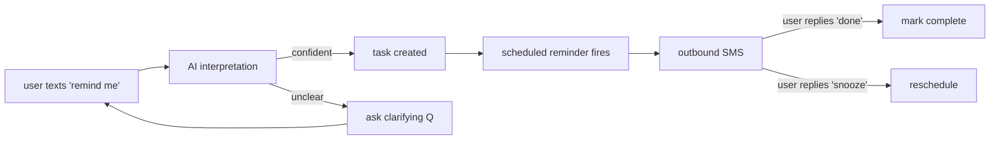

# BUILD PROTOCOL (version: the one line in `VERSION`, D-032)

> A systematic framework for building, auditing, and evolving products with Claude Code.
> Created: 2026-04-15. Last updated: 2026-09-13. Owner: Joe Wang.

---

## CONTEXT & PURPOSE

### Why This Exists

This protocol was created because "one-shotting" product specs and implementation plans with AI produces inconsistent results — even after 20+ iterations. The core problem: **Claude Code is extremely capable at execution but has no inherent process discipline.** Without guardrails, it builds things that drift from specs, silently refactors working code, invents behavior not defined anywhere, and produces outputs that require dozens of audit passes to correct.

This document codifies a methodology for how a non-engineer product leader creates products with Claude Code — optimized for someone who is strong at conceptual scoping and product design but relies on AI for implementation.

### What We're Optimizing For

1. **Comprehensive upfront design** — get foundations right so future iterations are easier, not build-as-you-go
2. **Guided sequential execution** — "do next step, do next step" with human review at each boundary, not manual copy-paste
3. **Spec-code consistency** — specs and code stay in sync throughout the build, not just at the beginning
4. **Cross-project learning** — mistakes from one project don't repeat in the next
5. **Human leverage** — the human's time goes to product judgment and decision-making, not technical review or debugging

### How This Was Derived (Evidence Base)

This protocol was reverse-engineered from 4 real projects built between January–April 2026:

| Project | What Happened | Key Lesson |
|---------|--------------|------------|
| **A real product build** | Most commits were fixes. No upfront specs. Definition drift (multiple copies of one taxonomy). Fix-after-fix chains. | **Build-as-you-go produces massive churn.** Spec-first is definitively better. |
| **A data-analysis tool** | 7,593 lines of specs → 7,090 lines of code in 3 days. Spec held with no deviations. 1 critical audit found real issues (74 parcel misclassifications). | **Comprehensive upfront specs + sequential phases = cleanest execution.** Even good specs need post-build auditing. |
| **A consumer task app** | 21 spec docs, 200K+ lines of code, 13 build phases. Copy-paste prompts. Specs never updated during build → 50+ items per audit pass × 5 audit passes. | **Upfront specs are necessary but not sufficient.** Mandatory reconciliation after each phase is the missing piece. Propagation enforcement prevents downstream rot. |
| **Strategy-research project** | Strategy-first: deep upfront specs (context docs, playbooks, agent specs) before any code. Behavioral and competitive research completed before implementation. | **Spec depth scales with product complexity.** The Behavioral Core pattern (how the system thinks) is reusable across AI products. |

### Core Thesis

**Write comprehensive specs upfront (the human's strength) → execute in sequential phases with human gates → mandate reconciliation after every phase to keep specs and code in sync → extract learnings to improve the next project.**

The protocol prevents the three failure modes observed across these projects:
1. **No specs** (a consumer AI app) → churn, drift, fix-after-fix
2. **Specs but no reconciliation** (a consumer task app) → spec-code divergence accumulates silently
3. **Specs but no propagation** (a consumer task app) → changing one spec doesn't update downstream specs that depend on it

---

## HOW TO USE THIS DOCUMENT

### Quick Start

Just tell Claude Code to read this file. You don't need to read it yourself — Claude will guide you.

**Simplest invocation:** "Read ~/.claude/build-protocol.md and help me use it for my project."

Claude will then ask which mode fits your situation:

---

**When the user references this file without specifying a mode, Claude MUST (v2.9 streamlined startup):**

1. **Silently detect state.** Check whether `docs/build-manifest.md` exists. Run `git status` if it's a git repo. Skim top-level files (package.json, framework configs, CLAUDE.md, recent commits) to infer project type and stage. **Never ask "is this the first time?" — it's a filesystem check.**
2. **Tentatively classify complexity** (Light / Standard / Heavy — see Complexity Assessment) from those signals. Propose with one-line reasoning, don't ask. State only the track + one-line reasoning. **Do NOT enumerate the "What Changes" column at startup** (skip Behavioral Core, skip Domain Specs, etc.) — those terms are jargon to a first-time user before mode selection. Surface each change later, only when it actually applies.
3. **Show ONE narration block** with: what you observed, the tentative complexity, and any housekeeping flags worth knowing before picking a mode (dirty git tree, missing manifest, conflicting docs, etc.). Then present the menu below and ask the single question: **which mode?**
4. **Narrator Mode is silently ON.** Do NOT announce it as a status line. Do NOT ask the user to confirm or choose terse vs narrator. Just be in narrator mode. User can switch at any point by saying "terse mode."
5. **Journey Map (§11.4) is shown only AFTER mode selection** — and only when the chosen mode is NEW for a first-time user. It is NOT a precondition for picking a mode, and never gates the conversation with a "does this look right?" confirmation.

Present this menu and wait for selection:

> **Which mode fits where you are?**
>
> | Mode | What it does | When to use | Roughly how long |
> |---|---|---|---|
> | **A) NEW** | Build a brand-new product from scratch. ~7 spec steps + build phases + hardening. | You're starting from zero or a fresh idea. | 4-12 sessions over 1-4 weeks |
> | **B) AUDIT** | Assess an existing, partially-built product. Maps what you have to the 5-document hierarchy, finds gaps, proposes a remediation plan. | You inherited code, or you've been building without a process and want to formalize. | 1-3 sessions |
> | **C) EVOLVE** | Add features or change an existing product. Classified Small / Medium / Large — bigger changes apply more of the build discipline. | You have a working product and want to extend it. | 1 session (Small) to 1+ week (Large) |
> | **D) UPGRADE** | Bring a project Bob set up earlier up to date with the current Bob — its hooks, reviewer, checks and templates. Shows each change and Bob's reason for it; applies only what you approve; leaves your deliberate differences alone. | Bob has improved since this project started, or `/bob` says the project is behind. | 5–15 minutes |
>
> **Which one? (A / B / C / D)** — or say "I'm not sure" / describe what you're trying to do and I'll recommend one.

After the user selects, Claude reads the relevant PART (II, III, or IV) and begins at Step 1 / A1 / E1. **UPGRADE** has no Part of its own: its steps (U1–U5) are in `build-protocol-core.md` §"MODE: UPGRADE" and the work is done by `scripts/bob-upgrade.mjs` (D-019). Claude does NOT need to read the entire document upfront — read Part I (Foundation, including §11 Narration Protocol) + the selected mode's section.

---

### Direct Invocation (if you already know which mode)

- **New product:** "Read ~/.claude/build-protocol.md. Use MODE: NEW to guide me through building [product name]. [Brief description of what it is.]"
- **Audit existing:** "Read ~/.claude/build-protocol.md. Use MODE: AUDIT to assess the current state of this project."
- **Evolve existing:** "Read ~/.claude/build-protocol.md. Use MODE: EVOLVE. I want to [describe the change]."

### Complexity Assessment

Before selecting a mode, assess project complexity to determine the appropriate process weight:

| Track | Criteria | What Changes |
|-------|----------|-------------|
| **Light** | 1-3 subsystems, no AI decisions, no multi-user, single integration surface | Skip Behavioral Core (Step 2). Skip Domain Specs if <3 subsystems — put details in Architecture Contract. Simplified Phase Report (always-required sections only). Skip adversarial reviews at spec phase — do them at hardening only. |
| **Standard** | 3-8 subsystems, AI decisions OR multi-user OR 3+ external integrations | Full protocol as documented. This is the default. |
| **Heavy** | Complex AI + multi-user + 5+ external integrations + compliance requirements | Full protocol + mandatory deployment verification at every phase + mandatory second-model review (ChatGPT) at spec and hardening gates + integration test suite required before Phase 2. |

If unsure, start at Standard. You can escalate to Heavy mid-build if you discover unexpected complexity, but downgrading from Standard to Light mid-build is risky — you've already skipped the foundations.

**Mid-build reclassification (escalating to Heavy):**

If you discover mid-build that the project is more complex than initially assessed:
1. **Future phases** follow Heavy requirements immediately (mandatory deploy verification every phase, mandatory second-model review at remaining spec and hardening gates)
2. **Catch-up audit** on completed phases: run a one-time review covering the gaps between Standard and Heavy — specifically, deploy verification for any phases that touched external integrations, and second-model review of the Product Spec, Architecture Contract, and Behavioral Core (if they weren't reviewed at the higher bar)
3. **Log the reclassification** in the Build Manifest with: date, which phase triggered it, rationale, and what catch-up work was done
4. **Do NOT retroactively re-run** completed phases — the catch-up audit covers the delta

### Rules for Claude Code

**Bob's rules live in one file: [`rules.md`](rules.md)** (D-028), filed by when you need them, with the failure stop conditions in its group 1. `build-protocol-core.md` has a one-line index. Rule numbers are the same everywhere.

### Role Division

| Role | Who | What |
|------|-----|------|
| **Product scoping & decisions** | Human | Defines what to build, reviews and approves all work, resolves ambiguities, makes tradeoff calls |
| **Adversarial review (specs)** | ChatGPT | Reviews Product Spec, Behavioral Core, and Architecture Contract for gaps and blind spots |
| **Drafting, building, verifying** | Claude Code | Writes specs, code, tests; runs validation; proposes reconciliations |

---

## PART I: FOUNDATION

*These concepts apply to all three modes. Read this section first.*

### 1. Document Hierarchy

Every product has up to 5 canonical documents. Together they are the complete source of truth.

| # | Document | Answers | Required? |
|---|----------|---------|-----------|
| 1 | **Product Spec** | WHAT it does. Vision, capabilities, scenarios, economics. True north star. | Always |
| 2 | **Behavioral Core** | HOW it thinks. Decision logic, confidence thresholds, autonomy boundaries, tone, conflict resolution. | Only if AI makes consequential decisions |
| 3 | **Architecture Contract** | HOW it's built. Tech stack, patterns, constraints, red flags, provider abstractions, security baseline. | Always (for code products) |
| 4 | **Domain Specs** | DETAILS of each subsystem. Data models, APIs, state machines, integration points, edge cases. | If product has 3+ subsystems |
| 5 | **Build Manifest** | WHERE we are. Phase list, current status, decisions made, deferred items, deviations from plan. | Always |

**Hierarchy rules:**
- Product Spec is supreme. If any doc contradicts it, Product Spec wins (or the Product Spec gets updated — never silently ignored).
- Behavioral Core governs all AI behavior. Code must implement it exactly. Drift here is the hardest bug to find.
- Architecture Contract governs all technical choices. No ad-hoc tool or pattern decisions outside it.
- Domain Specs are detailed implementations OF the Product Spec, not alternatives to it.
- Build Manifest is the only doc that tracks current state (what's done, what's in-progress). All other docs describe desired state.

**Source-of-truth priority (when docs conflict):**
1. Product Spec (vision, capabilities, scope)
2. Behavioral Core (decision logic, tone, autonomy rules)
3. Architecture Contract (tech stack, patterns, constraints)
4. Domain Specs (subsystem details, schemas, APIs)
5. Build Manifest (execution sequence, current state)

If behavior is defined in both the Product Spec and the Behavioral Core, the **Behavioral Core wins** — it is the single source of truth for all behavioral decisions. The Product Spec is vision; the Behavioral Core is implementation authority. System docs (domain specs) execute behavior defined in the Behavioral Core — they do not define new behavior.

**Global Spec Lock (MANDATORY):**

Claude MUST treat project specs as STRICT, NOT INTERPRETABLE.

1. If behavior differs from Behavioral Core → FAIL
2. If schema differs from the data model domain spec → FAIL
3. If API route differs from the API architecture domain spec → FAIL
4. If engine/pipeline logic differs from the relevant domain spec → FAIL
5. If behavior is derived from the Product Spec instead of the Behavioral Core (when Behavioral Core defines it) → FAIL

NO reinterpretation allowed. If ambiguity exists → STOP → ask for clarification → DO NOT choose an interpretation.

Implementation must EXACTLY match specs. "Close enough" is not passing.

**Supporting documents (non-hierarchical):**
- `decision-log.md` — Every non-obvious decision with rationale. Prevents re-litigating settled questions across sessions.
- `tool-decisions.md` — Tool comparisons and selection rationale (see Tool Stack section).

### Review Responsibility Matrix

The human and Claude review different things. This prevents the human from drowning in technical detail and prevents Claude from making product judgment calls.

| Claude Code handles (technical) | Human handles (product + business) |
|---|---|
| Does the code match the specs? | Does the product *feel* right? |
| Are invariants and architecture rules followed? | Do confirmations, messages, and alerts sound right? |
| Are there regressions from prior phases? | Would you trust this with your own data? |
| Is the schema/API/engine logic correct? | Do the unit economics work? |
| Are security and data isolation rules met? | Does the UX feel premium, not generic? |

**When reading Claude's phase report, the human should focus on:**
1. **User-facing output** — Read the actual messages, UI, and workflows. Does it feel right or generic?
2. **Spec changes proposed** — Do the proposed additions match your product vision?
3. **Deviations from spec** — Scan for anything that sounds like a product change, not just a technical choice
4. **Assumptions made** — Are any assumptions incorrect or undesirable?

**The human's Go/No-Go decision is about product quality, not technical correctness.** If Claude says "technically sound" but the output feels wrong — that's a valid NO-GO.

### 2. Folder Structure

```
project-name/
├── docs/                           # Specs and process — never runtime code
│   ├── product-spec.md             # Layer 1: WHAT
│   ├── behavioral-core.md          # Layer 2: HOW it thinks (if AI product)
│   ├── architecture.md             # Layer 3: HOW it's built (incl. threat model, observability, rollback posture, cost budget)
│   ├── build-manifest.md           # Layer 5: WHERE we are
│   ├── decision-log.md             # Non-obvious decisions with rationale
│   ├── tool-decisions.md           # Tool evaluations and choices
│   └── domains/                    # Layer 4: subsystem details (prose)
│       ├── [subsystem-1].md
│       └── [subsystem-n].md
├── contracts/                      # v2.2: Machine-readable contracts for subsystem boundaries
│   ├── [subsystem-1].ts            # (or .schema.json, .openapi.yaml, .proto, etc.)
│   └── shared.ts                   # Cross-subsystem shared types
├── evals/                          # v2.2: AI golden eval sets (if AI product)
│   └── behavioral-core.yaml        # Re-run at every AI-touching phase gate
├── src/ or app/ or lib/            # Application code
├── tests/ or __tests__/            # Test code
├── scripts/                        # Automation, deployment, audits
├── supabase/ or db/                # Database migrations (if applicable)
├── config/                         # Configuration files
├── .env.example                    # Environment template (never secrets)
├── CLAUDE.md                       # Claude Code project context (refs docs/, doesn't duplicate)
├── README.md                       # Human-readable project overview
└── package.json / pyproject.toml   # Dependencies
```

**Rules:**
- `docs/` is for specs and process only. Never put runtime code here.
- `CLAUDE.md` is a compact reference that points to `docs/` — it should not duplicate spec content. It contains: what this project is, current phase, architecture rules, red flags, build/deploy commands.
- Non-code products (strategy docs, analysis tools) may not have `src/` — that's fine. The `docs/` structure still applies.

### 3. Tool Stack Selection

#### When to Evaluate
- During Step 4 (Architecture Contract) — choose the primary stack
- When a build phase requires a capability you haven't selected a tool for
- When a current tool proves inadequate (log why in tool-decisions.md)

#### Evaluation Template

Record every tool decision in `docs/tool-decisions.md`:

```markdown
### [Capability Name] — [YYYY-MM-DD]
**Need:** [What capability is required and why]
**Options:**
| Tool | Pros | Cons | Cost (at 1K users) |
|------|------|------|-------------------|
| [A]  |      |      |                   |
| [B]  |      |      |                   |
| [C]  |      |      |                   |

**Decision:** [Tool chosen]
**Rationale:** [Why — reference the weighted factors below]
**Abstraction:** [Wrapped in provider abstraction? Y/N. If N, why not.]
**Revisit trigger:** [What would make us reconsider — cost threshold, feature gap, etc.]
```

#### Decision Factors (weighted)
1. **Simplicity** (30%) — Low config overhead? Claude Code can work with it effectively?
2. **Cost at scale** (20%) — What's the cost trajectory at 100 / 1K / 10K users?
3. **Lock-in risk** (15%) — How hard to switch? Proprietary API? Data portability?
4. **Ecosystem fit** (15%) — Works well with the rest of the chosen stack?
5. **Familiarity** (10%) — Have you or Claude Code worked with this before?
6. **Community & docs** (10%) — Good documentation = Claude Code can assist better

#### Provider Abstraction Rule
If there's >30% chance of switching providers within 12 months, wrap the integration in a provider abstraction from day one. This costs ~1 hour upfront and saves weeks later.
- Common abstractions: messaging (SMS/push), AI models, email, payments, calendar, storage
- Don't abstract everything — only capabilities where the market is shifting or you're uncertain

#### Orchestrate, Don't Reinvent (v2.16 — load-bearing principle)

Before building anything custom that wraps a capability the open-source world has already converged on, **orchestrate the incumbent** instead. The protocol prose should name specific tools; Bob does not maintain a Bob-flavored re-implementation.

This is now an explicit selection rule on top of the 6 Decision Factors above. When evaluating a capability:

1. **Convergence check.** Has the field converged on 1-2 incumbent tools for this capability (each with mature CLI + JSON output + active maintenance)? If yes, default to orchestrating the incumbent. Examples (current at v2.16): Knip for JS/TS dead-code; Schemathesis for HTTP fuzz; Playwright for browser smoke; Vitest/pytest for unit; promptfoo for LLM evals; Inngest/Temporal for durable jobs; Stripe for payments.
2. **Custom build threshold.** Only build custom when (a) no convergence exists, (b) the incumbent is unmaintained without a clear successor, OR (c) the abstraction *itself* (not the underlying capability) is your product's differentiation.
3. **Document the choice.** Every tool decision in `tool-decisions.md` includes an explicit "Considered orchestrating: [tool]; chose to [orchestrate/build] because [reason]" line — even when the choice is obvious. This creates an audit trail and prevents silent reinvention.

**Why this is a principle, not a one-off:** D-003 (A7j orchestrates incumbent OSS tools) and audit-log F32 (F27 reshaped from script to per-stack prose) are both instances of this rule. Promoting it to a Section 3 principle makes it fire on every tool decision, not just the ones that happened to surface in audits.

**Anti-pattern this prevents:** the "Bob-flavored X" trap — building a wrapper that lags the underlying tool, adds a maintenance tax with no proportionate value, and creates lock-in that contradicts Bob's stance as a methodology.

### 4. Memory & Lessons

#### What Gets Saved (automatically by Claude Code)

| Trigger | What to Save | Where |
|---------|-------------|-------|
| Non-obvious decision made | Decision + rationale | `decision-log.md` |
| Tool surprised us (good or bad) | Finding + impact | `tool-decisions.md` |
| Human corrected Claude's approach | The correction + why | Feedback memory file |
| Phase revealed something specs missed | The discovery | Updated spec + decision-log |
| Project milestone completed | Key learnings | Project memory file |
| Process step felt wasteful or was skipped | Observation | Flag for Build Protocol update |

#### Memory Hygiene Rules
- Check for existing memory before creating new (no duplicates)
- Merge overlapping memories
- Never duplicate CLAUDE.md or docs/ content in memory
- MEMORY.md = one-line index entries, <150 chars, always pointers to detail files
- Archive project memories when project is stable for 3+ weeks

#### Cross-Project Learning
When starting a new project, Claude should:
- Check if similar to a past project (same stack, same domain, same product type)
- Surface relevant lessons and known pitfalls
- Reference tool decisions from similar projects (don't re-evaluate tools you've already chosen unless there's a reason)

### 5. Context & Session Management

Context window degradation is the #1 cause of quality drop-off in long build sessions. Claude doesn't hit a wall — it degrades gradually: inconsistency and "forgetfulness" appear well before the hard limit.

**Rules:**
- **`/clear` between unrelated tasks.** If you finish a build phase and want to ask an unrelated question, clear first. Mixed-context sessions produce the worst outputs.
- **`/compact` proactively, not reactively.** Run it after completing a significant sub-step, before starting the next. Don't wait for degradation signals. Add to CLAUDE.md: *"When compacting, always preserve: the current build phase, list of modified files, pending decisions, and test commands."*
- **Use subagents for investigation.** When Claude needs to research the codebase (reading many files), dispatch a subagent. It runs in a separate context window and reports back a summary, keeping your main context clean.
- **Two-correction rule.** If you've corrected Claude more than twice on the same issue, the context is polluted with failed approaches. `/clear` and start a fresh session with a better prompt that incorporates what you learned. A clean session with a better prompt almost always outperforms a long session with accumulated corrections.
- **Scope file reads explicitly.** "Read only `src/services/billing.ts` for this task" saves enormous context vs "look at the billing system." For large files: "Focus on the `processRefund` function specifically."
- **Session boundaries at phase boundaries.** Each build phase (Na/Nb/Nc) is a natural session boundary. If context is getting heavy, start a fresh session at the next phase — the Build Manifest carries state across sessions.

**Session budget heuristics:**

These are rough expectations, not commitments — actual session length depends on complexity, context load, and iteration cycles:
- **Spec steps** (Steps 0-5): Expect 1-2 sessions for Light track, 2-4 for Standard, 4-6 for Heavy. Each spec step (draft → stress-test → adversarial) can usually fit in one session.
- **S-complexity phases:** ~1 session (build + verify + reconcile)
- **M-complexity phases:** 1-2 sessions. Start a fresh session if verify reveals significant issues.
- **L-complexity phases:** 2-3 sessions. Consider splitting: session 1 for build, session 2 for verify + reconcile.
- **Hardening audits:** 1 session per audit (a/b/c/d/e). Each MUST be a fresh session (writer/reviewer pattern).

If a phase takes more than 3 sessions, it's likely too large — consider splitting it in the Build Manifest.

**Context health indicators:**
- At 50%+ capacity: be more explicit in instructions, scope file reads tightly
- At 70%+: `/compact` immediately, consider fresh session
- At 85%+: start a new session — quality is unreliable from here

### 6. Reconciliation Protocol

#### When to Reconcile
- After every build phase (the Nc step — mandatory, never skip)
- After every Medium+ evolution (EVOLVE mode, Step E5)
- When an audit finds inconsistencies
- When the human flags something that "doesn't match the spec"

#### How to Reconcile
1. **Identify the divergence:** Spec says X, code does Y (or vice versa)
2. **Determine which is correct:**
   - Spec is right → fix the code
   - Code is right (learned something during build) → update the spec
   - Neither is clearly right → flag for human decision
3. **Check downstream impacts:**
   - Does this change affect other domain specs?
   - Does this change affect the Build Manifest timeline or scope?
   - Does this change affect the Architecture Contract constraints?
   - Does this change affect the Behavioral Core logic?
4. **Update all affected documents** — not just the one that diverged
5. **Log the reconciliation** in decision-log.md with rationale

#### Propagation Enforcement (MANDATORY when specs change)

If any spec is modified during a phase, Claude MUST:

1. **Scan ALL future build phases** for references to the changed file/section
2. **Explicitly state whether those phases are impacted** — list each affected phase by name and explain what changed
3. **Flag impacted phases in the Build Manifest** — mark them with a note: "Re-read [spec file] before executing — modified in Phase [N]"

Claude MUST NOT:
- Proceed silently after a spec change
- Assume future phases will "figure it out" when they load the updated spec
- Defer propagation to a later phase without explicit acknowledgment

**If a spec was modified and the propagation section of the Phase Report says "None" — that is a failure condition.**

#### The Anti-Pattern This Prevents
In a consumer task app, specs were written comprehensively upfront (good) but never updated during build (bad). By Phase 8, the Phase 3 data model had changed but the Phase 8 domain spec still referenced the old schema. This wasn't caught until audit passes found 50+ items. Reconciliation + propagation enforcement after every phase prevents this accumulation.

### 7. Quality Gates

| Gate | When | Pass Criteria |
|------|------|---------------|
| **Spec Gate** | After all specs written (Steps 1-5 in NEW mode) | Specs are internally consistent; ChatGPT has reviewed Product Spec + Architecture + Behavioral Core |
| **Phase Gate** | After each build phase (Na/Nb/Nc) | All checks below pass; specs reconciled; propagation complete |
| **Hardening Gate** | After all build phases complete | Security audit, data integrity audit, and spec-code consistency audit all pass |
| **Ship Gate** | Before launch | All hardening items resolved or explicitly deferred with rationale |

**Phase Gate detail (System Integrity Check — required before every phase transition):**

1. **Build check:** Code compiles, types check, no errors. Machine-readable `contracts/` validate.
2. **Test check (by type):**
   - **Unit tests:** All pass. These catch logic errors within modules.
   - **Integration tests:** All pass. These catch contract mismatches between subsystems. At minimum, one integration test must exercise the project's hot path(s) end-to-end.
   - **Deployment tests** (if phase touches external integrations, webhooks, or auth): Deploy to staging/preview environment and confirm at least one real request succeeds. "It compiles" is not "it works."
3. **Liveness check on phase deltas (v2.15):** For every new/modified route, exported function, background job, and AI call site introduced this phase, run a scoped smoke (Knip + curl/fetch for routes, Vitest/pytest one-liner for functions, promptfoo single-shot for AI). Any reachable surface that 5xx's or throws on first call is a stop condition. See `[N]b` Liveness check for the full method and skip conditions.
4. **Hot path check:** Run the project-wide hot path(s) defined in the Build Manifest. Hot path failure is a stop condition — do not advance.
5. **AI eval check (v2.2):** If phase touched AI behavior, re-run `evals/behavioral-core.yaml`. A drop in pass-rate vs prior phase is a stop condition.
6. **Cost guardrail check (v2.2):** If Architecture Contract defines a per-request cost budget, measure actual cost. Exceeding the budget is a stop condition.
7. **Regression check:** Re-test critical flows from ALL prior phases. If any prior flow is broken → fix before advancing.
8. **Global invariants:** Re-verify all project invariants (see Appendix E). If any violated → fix before advancing.
9. **Spec consistency:** Confirm implementation still matches domain specs, Architecture Contract, and Behavioral Core. If drift detected → reconcile before advancing.
10. **Fresh-eyes clean on Tier-1 deliverables (v2.39 — Rule 30):** Tier the phase's output by consequence — **Tier 1** = numbers or data someone acts on (financials, health data, scoring, pipelines, migrations, backfills, any join / collapse / dedup / group step, anything feeding a displayed figure); **Tier 2** = code without numbers; **Tier 3** = thinking work. For Tier 1: after the builder's own Rule-25 forensics, hand the artefacts + spec to a **fresh-context auditor** (a new subagent or session that did NOT build the phase) to run the scoped lens panel plus a plain re-read against the ask. Triage every finding **Material** (changes a displayed number, a decision, or data completeness) / **Minor** / **Cosmetic**. Material findings open = stop condition; fix and re-audit until zero. Log the audit in `docs/audit-ledger.json` — `{audit, ran, tier, class_of_work, material_found, material_remaining, minor, cosmetic, auditor_context}`, class from the ledger's fixed vocabulary — and run `node "$(realpath ~/.claude/skills/bob/..)/scripts/audit-ledger-check.mjs" docs/audit-ledger.json` (D-018). Three rules keep "clean" honest (Rule 30(f)): **a zero-finding audit is re-run once from a different angle** before it is accepted; **editing content an audit or receipt covered voids that proof** until it is re-run; **done means the observed end effect** (the message arrived, the served value changed, the first scheduled run produced its output) — never "merged" or "deployed". Tier 2/3 phases record their tier and skip. Never wait for the human to ask for this audit — it is the phase's exit, not a favor.
11. **Failing-test receipt per fix item (2026-10, D-016):** Every fix or bug item in the phase must **name the test command that proves it**; an item with only a note ("fixed, checked by hand") cannot pass. A session **different from the builder's** — the milestone `reviewer` subagent or a new session — runs `node "$(realpath ~/.claude/skills/bob/..)/scripts/prove-test-fails.mjs" --commit <sha> --test "<cmd>" --fix <file>:<from>-<to>`. In a scratch copy at that exact commit it removes the named fix lines and requires the test to **FAIL**, then restores them and requires it to **PASS**, and prints a short receipt tied to the commit hash. Paste the receipt into the phase report. A test that stays green with the fix removed is not testing the fix → stop condition. *(Method ported from pullboard's guard-revert, MIT — see `third_party/README.md`. Pullboard itself accepted an item that named no test; Bob closes that gap by refusing such items.)*
12. **Done-criteria unchanged since the phase began (2026-10, D-016):** When a phase starts, its done-criteria get a fingerprint (`node "$(realpath ~/.claude/skills/bob/..)/scripts/check-bar.mjs" --stamp <phase-report.md>`, recorded in the report's Acceptance Bar block). At the gate, `node "$(realpath ~/.claude/skills/bob/..)/scripts/check-bar.mjs" <phase-report.md>` recomputes it. If the criteria changed, the gate refuses unless the report carries a dated `bar changed because …` line, after which the new fingerprint is recorded. Quietly moving the finish line mid-phase is the failure this catches.
13. **Phase report complete (2026-10-29, D-033 — Rule 4):** `node "$(realpath ~/.claude/skills/bob/..)/scripts/phase-report-check.mjs" <phase-report.md>` refuses a report whose always-required ([A]) sections are missing, empty or still the template's placeholder text — so reconciliation can no longer be skipped silently. If nothing diverged, "Spec Deviations" says "None" or "No divergences found" (either passes). A short report under time pressure (Minimum Viable Process) is checked with `--abbreviated`.
14. **Nothing still names a file this change moved, deleted or gutted (2026-10-29, D-033 — Rule 26):** `node "$(realpath ~/.claude/skills/bob/..)/scripts/run-commands-check.mjs" --base <commit the phase started from>` asks git what the phase deleted, renamed or stripped of its `if __name__ == "__main__":` block, and refuses when a run config still names that file — package scripts, CI workflows (not their `paths:` filters), a Makefile, Procfile, Dockerfile, compose file, schedule or pyproject entry point; by path, by `python -m` module, or by bare file name when no other file has that name. Run it after any move, rename or wrap. It matches names as text: it cannot see a command that was broken before the phase, a name built from a variable, or a file named outside those configs. On main or in a CI clone, pass `--base`; without one it reports that it cannot judge.
15. **No recurring defect closed too low (2026-10-29, D-033 — Rule 31):** when the phase fixed a defect, `node "$(realpath ~/.claude/skills/bob/..)/scripts/recurrence-check.mjs"` refuses a class of defect fixed twice whose newest fix is below rung 3 (a fresh-context read where it can come back, or making it impossible). It reads `Class:` and `Rung:` lines in fix commit messages; with none yet it reports it cannot judge — record that and skip.

If ANY check fails → fix before proceeding. Do NOT advance to next phase with known regressions or invariant violations.

**Optional — folder ownership when several sessions build in parallel (2026-10, D-016).** If the project splits work into lanes (e.g. one session on the web app, one on the data pipeline), write the split down as a register at `docs/lanes.md` — a table of *lane · branch-name prefixes · folders/files it owns* (a lane named `shared` is open to all) — and run `node "$(realpath ~/.claude/skills/bob/..)/scripts/lane-check.mjs"` before each commit. It maps the current branch to a lane by its name prefix and lists any changed file that belongs to another lane. **Default is warn-only** (prints, never blocks); add `--enforce` once the register matches how the work is really split. If the machine uses a global hooks folder (`git config --global core.hooksPath`), per-repo hooks are ignored, so the call goes in the global pre-commit script, gated on the register existing — the exact snippet is in the script's header. Bob never edits a user's global hooks or an existing project for them; wiring it in is the user's explicit step. *(Logic ported from pullboard's lanes, MIT. Origin: in a real multi-lane build, the lanes lived only in prose, and an out-of-lane commit from a lab branch was accepted silently by the existing hooks.)*

**Parallel sessions — one open-loops list, one coordinator (2026-10-27, D-018).** When more than one session works on the project at once (several Claude Code tabs, an overnight job, the owner in between), work gets dropped *between* sessions: each assumes another has it. In a real build a plan sat in an open pull request for more than a week and its findings never reached the plan of record. The rules, all from that build's own coordination:
1. **One open-loops list** — `docs/open-loops.md`, from `templates/open-loops.md`. Every open item across all sessions and the owner is one row: **ID · item · owner · next action · due date · closing proof · status**.
2. **One coordinator session** owns the list, assigns work within the plan the owner approved, and is the **only** session that merges and writes to production (database writes, switches, deploys). Other sessions propose — branches, pull requests, reports. A write refused in one session is never re-routed through another.
3. **Every finding gets a home in the same change.** An audit, review or overnight run is not done until each finding is a row (owner + due date), a dated item in the plan, or a written "won't do" with the reason.
4. **Close a row only with proof** — a pull request, commit, run or record. "Done" in a message is not proof.
5. **The list stays countable:** exactly three status words (`open` / `waiting` / `closed`), unique row IDs that are never reused (`L-001`, `L-002`, …), and **one row ≤ ~600 bytes** — detail goes in a linked note. *(These three were added after the list's first real re-run: free-form status words, re-used IDs and paragraph-long rows had made a list nobody could scan or count.)*
6. **Coordination must not depend on any one session staying alive.** The daily loop check (`scripts/loop-check.mjs`, installed by `bob-init`) reads the list from the repo every day and flags a row with no owner, next action or due date, a row past its due date, a closed row with no proof, a fourth status word, a duplicate ID or an oversized row — plus pull requests open more than 72 hours with no `hold-until:YYYY-MM-DD` label, and scheduled jobs failing twice or not running. Its failed run is the email that reaches the owner.
7. **Re-read the list before telling the owner what they still owe** — never from memory; it may have been closed an hour ago in another tab.
Combine with the folder-ownership check above when the sessions also split the code.

**Human Gates (`→ HG`):**
- Claude presents work and waits for explicit approval
- Human can: **approve** (advance), **revise** (request changes), **reject** (redirect entirely), or **defer** (log it, skip, revisit later)
- Deferred items are saved to Build Manifest deferred list — they don't disappear
- "Approve" means "advance to next step." Nothing else does.

### 8. Protocol Effectiveness Metrics

Track these metrics per project to measure whether the protocol is improving outcomes:

| Metric | What It Measures | Target | Where Tracked |
|--------|-----------------|--------|---------------|
| **Deviation count per phase** | Spec-code fidelity | Declining over consecutive phases | Build Manifest |
| **Fix commits / total commits** | Build quality | <30% | Git history |
| **Audit finding count at hardening** | Cumulative quality | <10 critical items | Hardening report |
| **Phase completion consistency** | Process predictability | Similar effort per similar-sized phase | Build Manifest |
| **Spec changes per phase** | Upfront spec quality | Declining after Phase 3 | Build Manifest |

**Deviation trend rule:** If the deviation count is NOT declining over 3 consecutive phases, trigger a process review before starting the next phase. Diagnose: Are specs unclear? Is Claude loading the wrong spec? Is context too long (degradation)? Is the phase scope too large?

### 9. Minimum Viable Process

If time pressure forces you to cut steps, follow this priority order. **Never skip** the first group. Cut from "Skip first", then "Skip with caution". (These groups used to be called Tiers 1–3; they were renamed so they do not clash with Rule 30's tiers.)

| Group | Steps | Why They're Essential |
|------|-------|---------------------|
| **Never skip** | Reconciliation ([N]c), Regression check, Scope lock, Class-level pattern scan, Hot path test, **Liveness check on phase deltas (v2.15)**, **AI eval re-run (AI products only)**, **Machine-readable contract validation (code products)** | These prevent compounding errors. Skipping them creates debt that grows exponentially. |
| **Skip with caution** | Cross-cutting concern scan, Global invariant check, Full Phase Report (use abbreviated — `phase-report-check.mjs --abbreviated`), Propagation enforcement, **Cost guardrail check** | These catch subtler issues. Skipping them is survivable for 1-2 phases but not more. |
| **Skip first** | Adversarial reviews (spec phase, including 4c), Experience test, Second-model review, Cowork session template, Detailed module inventory | These improve quality but their absence doesn't compound. Defer to hardening. |

**The escape valve rule:** If you skip "Skip with caution" or "Skip first" steps during build, you MUST run them at hardening. Hardening is NOT optional even if build phases were compressed.

### 10. Debugging Protocol

When a bug is discovered during verification or after deployment, follow this sequence instead of ad-hoc debugging:

1. **Reproduce:** Confirm the failure. Define the exact input → expected output → actual output. **The obvious cause is often a red herring** (Engineering Principle 8a): a failure that starts right after a dependency upgrade, a config change or a new deploy is not proof that the change caused it. Before blaming it, check what the **last good run** actually used — versions, config, inputs. If the last good run used the same versions, the upgrade is not the cause. Fix only a cause you have reproduced; a fix to the wrong cause wastes the cycle and hides the real defect.
2. **Isolate:** Which subsystem owns this failure? Trace the data flow until you find where expected ≠ actual (Engineering Principle 2 — trace end to end; don't patch the symptom).
3. **Check spec coverage:** Does the spec define behavior for this case? If not → this is a spec gap, not just a code bug. Patch the spec first.
4. **Fix:** Apply the targeted fix to the isolated subsystem.
5. **Class-level scan:** Grep the entire codebase for the same pattern. If you found `.single()` should be `.maybeSingle()` in one query, check ALL queries. Report: "Found N additional instances. Fixed all."
5b. **Read two neighbouring code paths:** the callers of the code you changed, and the code that runs next to it on the same data. A fix that changes a function's inputs or outputs is Engineering Principle 5 — every caller is updated in the same change.
6. **Add regression test:** Write a test that would have caught this bug. This prevents recurrence.
7. **Update spec if gap found:** If the bug revealed a spec gap (Step 3), update the relevant spec and run propagation enforcement.

**Anti-pattern this prevents:** The "spray and pray" debugging pattern — adding logging, trying random fixes, bypassing checks, adding temporary endpoints — which produces chains of 5-6 commits that should have been one. (Observed: a consumer task app's Twilio webhook debugging required 6 commits; structured debugging would have required 1-2.)

**Three-strikes integration:** If the same fix fails 3 times following this protocol, STOP. The bug is not where you think it is. State what was tried, what was ruled out, and change approach entirely.

### 10.5. Skill Leverage Map (v2.7)

Bob orchestrates the methodology; Claude Code skills provide domain-specific guidance bundles. At specific steps, Claude should invoke the matching skill to get current best-practice advice without Bob having to maintain that material.

> **Important — verify before relying:** Skill names listed here reflect Anthropic's published skill ecosystem as of 2026-05-15. The skill catalog evolves; before invoking, confirm the skill is current via Claude Code's `/help` or skill listing. If a skill has been renamed/replaced, use the current name; if it's been removed, fall back to inline guidance in Bob.

| Bob step | Skill to invoke | Why |
|---|---|---|
| 3a (Architecture Contract) — choosing AI provider/routing | `vercel:ai-gateway` | Current routing/failover/cost-tracking configuration guidance |
| 3a — Vercel-hosted projects | `vercel:bootstrap`, `vercel:deployments-cicd`, `vercel:vercel-storage` | Platform-specific setup patterns |
| 3a — security baseline + threat model | `security-review` | Up-to-date threat-model and security-baseline patterns |
| 2d (eval harness) — for AI products | `claude-api` | Prompt caching, model selection, eval patterns for Anthropic SDK |
| 6c (repo init) — Vercel projects | `vercel:bootstrap` | Provisioning Vercel-linked resources safely |
| 6c — Next.js projects | `vercel:nextjs`, `vercel:next-cache-components` | App Router, RSC, Cache Components patterns |
| 6c — shadcn/ui projects | `vercel:shadcn` | Component installation and theming |
| [N]a Build (any phase touching middleware/auth) | `vercel:routing-middleware`, `vercel:auth` | Routing middleware + Clerk/Descope/Auth0 integration |
| [N]a Build (functions/cron) | `vercel:vercel-functions` | Serverless/Edge/Fluid Compute + Cron Jobs configuration |
| [N]a Build (background jobs) | `vercel:workflow` | Durable workflow patterns (alternative to Inngest/Trigger.dev) |
| [N+1]a Security audit | `security-review` | Adversarial review focused on actual attack surface |
| [N+1] Hardening — any phase | `vercel:verification` | End-to-end flow verification |

**Rule:** Bob's per-step content remains canonical for methodology (when to do something, why, what success looks like). Skills provide current tactical guidance (specific configs, current SDK shapes, latest patterns). When they disagree, Bob's methodology wins on process; the skill wins on current tactical detail.

### 11. Narration Protocol (v2.3 — for guiding non-engineer users)

The rest of this protocol tells Claude *what to produce*. This section tells Claude *how to narrate the journey* so a non-engineer user knows where they are, what's happening, and what's coming next.

**Default state:** Narrator Mode is **ON** for any session that enters NEW mode. The user can disable it with "skip narration" or "terse mode" at any point. Returning users with an existing Build Manifest get a condensed narration (skip the journey map and glossary primers — they've seen them).

#### 11.1 — The Ten Narration Rules

1. **Open with orientation.** On the first turn of a NEW mode session, before mode selection, show the Journey Map (§11.4). Confirm: "Does this look like what you're trying to do?" Don't proceed until the user has the shape of the thing in their head.

2. **Use the Preamble Template at every step entry.** Before drafting Step 1a, Step 2a, Step 3a, etc., narrate per §11.2. Never just start producing the artifact without context.

3. **Define jargon inline on first use.** When a term from Appendix J appears for the first time in a session, define it in one sentence inline before using it normally. Don't make the user go look it up.

4. **Make every Human Gate (`→ HG`) explicit about choices.** When pausing for approval, state the user's four options every time: *approve* (advance), *revise* (request changes), *reject* (redirect entirely), *defer* (log it, skip, revisit later). Don't assume the user remembers them.

5. **Use the Checkpoint Summary Template after every step completion.** After Step 1c (Product Spec done), Step 2d (Behavioral Core done), etc. — narrate per §11.3 before advancing.

6. **Show progress at every step entry.** Use the Build Manifest progress tracker format (§5b): `Spec phase: ▓▓▓▓░░░ 4/7 complete. Next: Step 3 Architecture Contract.`

7. **Match action items to user expertise.** If user's project CLAUDE.md or the global CLAUDE.md flags them as a non-coder, every actionable step gets the paste-ready block format: (a) what app/window to open, (b) the exact block to paste, (c) one plain-language line on what it does. No bare commands in prose.

8. **Catch confusion signals.** If the user says "I don't get it", "what does that mean", "why are we doing this", "is this normal", or expresses uncertainty — STOP, switch to plain-English explainer mode, and resolve before continuing. Don't power through.

9. **End each session with a Pulse Report.** Before the user closes the tab, narrate: (a) where we are in the Journey Map, (b) what got produced this session, (c) what's the next step when they resume, (d) any open questions Claude asked that the user didn't fully answer.

10. **Stay narrator, not lecturer.** Narration is short and frequent, not long and rare. A one-sentence "we're about to do X because Y" beats a 200-word explainer every time. If you're writing more than 3-4 sentences of narration in a row, you're over-explaining.

#### 11.2 — Preamble Template (use at every step entry)

> **🟦 Step [N.x] — [Step Name]**
> **What we're doing:** [One sentence, plain English. Avoid jargon or define it inline.]
> **Why now:** [What we just finished + what this step enables. The chain.]
> **What I'll ask you:** [Concrete preview of the questions Claude is about to pose.]
> **What "done" looks like:** [The artifact — what file/document will exist, in plain English.]
> **Time:** [Realistic estimate: "1 session", "2-3 turns", etc.]
> **At the Human Gate, you can:** approve / revise / reject / defer.
> **Progress:** [Use the progress bar format.]

#### 11.3 — Checkpoint Summary Template (use after every step completion)

> **✅ Step [N.x] complete — [Step Name]**
> **📦 What we now have:** [The artifact, in 1-2 sentences. Where it lives. What it says.]
> **💎 Why this matters (v2.5):** [Plain-English explanation of what this artifact does for you over the next few weeks. Sell the value. A non-coder needs to feel that the time they just spent was worth it — and a clear "why" also primes them to push back if the artifact is weak. Example: "Without this Product Spec, every future build phase would have to re-litigate 'what are we even doing?' With it, when a question comes up at Phase 5 about whether feature X is in scope, the answer is in one place. This is the artifact that prevents scope creep."]
> **📏 Quality Bar self-check (v2.11):** [Cite the relevant §11.7 Quality Bar criteria and self-rate against each. Be honest — under-rate if borderline. Example: *"Against §11.7 Product Spec criteria: success metrics defined ✓, non-goals listed ✓, scenarios cover happy + 2 edge cases ✓, data classification stated ✓, activation defined — partial (we have 'first message sent' but not target time-to-first-message). Overall: 4/5. The activation gap is the one thing to push back on if you have a target in mind."* This lets the non-engineer ride along on the judgment instead of being asked cold. If self-rating is <4/5 on any criterion, surface it before the HG — don't bury it.]
> **🚀 What this unlocks:** [The next step + why it depends on what we just produced.]
> **⚠️ Risks if we skip something later:** [Optional — only if a future step might be tempting to skip. E.g., "If we skip the eval set in Step 2d, we won't catch behavioral regressions during build."]
> **Progress:** [Updated progress bar.]

#### 11.4 — Journey Map (show on first contact, before mode selection)

> Here's the full journey for building a new product with this protocol:
>
> ```mermaid
> flowchart TD
>     A[Step 0<br/>Intake<br/><i>existing materials, if any</i>] --> B[Step 0.5<br/>Project Profile<br/><i>RAG? Agent? Marketplace?</i>]
>     B --> C[Step 1<br/>Product Spec<br/><i>WHAT it does</i>]
>     C --> D[Step 2<br/>Behavioral Core + Eval Set<br/><i>HOW the AI thinks</i><br/><i>if AI product</i>]
>     D --> E[Step 3<br/>Architecture Contract<br/><i>HOW it's built</i>]
>     E --> F[Step 4<br/>Domain Specs + Contracts<br/><i>DETAILS per subsystem</i>]
>     F --> G[Step 5<br/>Build Manifest<br/><i>PLAN of phases</i>]
>     G --> H[Step 6<br/>Project Setup<br/><i>repo, hooks, environment</i>]
>     H --> I[Steps 7+<br/>Build Phases<br/><i>actual building, one phase at a time</i>]
>     I --> J[Step N+1<br/>Hardening<br/><i>5 fresh-session audits</i>]
>     J --> K[Step N+2<br/>Learning Extraction<br/><i>what worked, what to improve</i>]
>
>     style C fill:#dbeafe,stroke:#1e40af
>     style D fill:#dbeafe,stroke:#1e40af
>     style E fill:#dbeafe,stroke:#1e40af
>     style F fill:#dbeafe,stroke:#1e40af
>     style G fill:#dbeafe,stroke:#1e40af
>     style I fill:#fde68a,stroke:#92400e
>     style J fill:#fecaca,stroke:#991b1b
> ```
>
> - **Blue = spec phase (Steps 1-5)** — we talk through your product, capture decisions, no code yet. ~1-4 sessions.
> - **Yellow = build phase (Steps 7+)** — code happens here. ~1-2 sessions per phase.
> - **Red = hardening** — separate fresh-session audits before ship. ~1 session per audit.
>
> **Total:** Roughly 4-12 sessions over 1-4 weeks, depending on complexity.
>
> We'll pause for your approval at every gate (`→ HG`). You can always stop, redirect, or defer items.

#### 11.5 — Session Open Checklist (every NEW session)

Before doing anything else (v2.9 streamlined):

1. **Silently** check whether `docs/build-manifest.md` exists. **Yes** → returning user, condensed narration per §11.6. **No** → first-time user; show Journey Map (§11.4) AFTER mode selection, not before.
2. **Do NOT announce narrator status.** Narrator Mode is silently ON. The user already knows — it's the default. Announcing it on every session is friction, not service. User can opt out with "terse mode" at any time.
3. For returning users: state where we are in the Journey Map and what's next, in one Pulse Report line.

#### 11.6 — Condensed narration for returning users

Returning users (Build Manifest exists) skip the Journey Map and jargon primers. They still get:
- Progress bar at every step entry
- Preamble Template (shortened to 3 lines: what / why now / what "done" looks like)
- Checkpoint Summary after each step
- Pulse Report at session end
- Inline jargon definitions ONLY for terms not previously used in this project's specs

#### 11.7 — Quality Bar Templates (v2.5)

The Preamble Template's "what 'done' looks like" line should reference these rubrics when the step has one. Each rubric: (a) the bar for "good enough to advance", (b) a concrete weak example, (c) a concrete strong example, (d) stop-iterating criteria.

**Quality Bar — Product Spec (Step 1a)**

- ✅ **Good enough to advance:** Every capability has a concrete user scenario behind it. Each user scenario passes the "can a stranger act this out?" test. Success metrics are measurable, not aspirational. At least one non-goal is explicit. A skeptical reader can't poke an obvious hole in the value proposition.
- ❌ **Weak:** "Users can manage their tasks. The system will be intuitive and helpful. We'll measure success by user satisfaction."
- ✅ **Strong:** "A user can text a half-formed task ('remind me to call mom tonight') and have it appear in the portal at the right time with the right context — without ever opening an app. We measure success by weekly active task-creators (north star) and the % of texted tasks that get marked complete within their timeframe (leading indicator). Non-goals for v1: project management, team collaboration, calendar sync."
- 🛑 **Stop iterating when:** the human can describe the product from memory in 30 seconds without checking the doc; and a colleague unfamiliar with the project can read the spec and predict the right answer to "is feature X in scope?" 8 times out of 10.

**Quality Bar — Behavioral Core (Step 2a, AI products)**

- ✅ **Good enough to advance:** Every decision the AI makes has a rule. Every rule has a confidence threshold or a deterministic trigger. Every "never" / "always" rule has at least one adversarial test in the eval set (Step 2d). Tone is defined with concrete examples, not adjectives.
- ❌ **Weak:** "The AI should be friendly and helpful. It should avoid being too pushy. It should ask for confirmation when unsure."
- ✅ **Strong:** "If confidence ≥ 0.85 → execute silently. 0.5-0.85 → execute + show a one-line confirmation ('I scheduled it for 7pm — say nope if wrong'). <0.5 → ask one targeted question, never two. Tone: warm and brief, like a competent assistant — never apologetic, never robotic. Example warm: 'Got it — calling mom at 7.' Example NOT warm: 'I have successfully created your task.' Refuse and explain when: the request involves money, the user's identity, or another user's data."
- 🛑 **Stop iterating when:** the rules are concrete enough that two different engineers reading them would implement the same behavior.

**Quality Bar — Architecture Contract (Step 3a)**

- ✅ **Good enough to advance:** Tech stack is chosen with a written rationale (`tool-decisions.md`). Every external integration has an abstraction-or-not decision. Cost-per-user at 100/1K/10K is estimated (range is fine; absent is not). Threat model lists ≥3 plausible threats with mitigations. Observability plan names specific metrics, not categories.
- ❌ **Weak:** "We'll use a modern stack with appropriate security and monitoring."
- ✅ **Strong:** "Next.js 16 + Supabase (Postgres + Auth + RLS) + Vercel for hosting + Anthropic Claude Sonnet via AI Gateway. Cost at 1K users: ~$180/mo (DB $50, Vercel $25, AI ~$105 @ $0.10/active-user-day). Threat model: (1) prompt injection from user task text — mitigation: sanitize + system-prompt isolation. (2) cross-tenant data leak — mitigation: RLS on every table. (3) webhook spoofing — mitigation: signature verification. Observability: log every AI call with tokens + cost + latency; trace SMS-in → AI → SMS-out as one span; alert on p95 latency > 8s or error rate > 2%."
- 🛑 **Stop iterating when:** the architecture lets the human estimate cost and identify failure modes without re-asking Claude.

**Quality Bar — Domain Specs (Step 4b)**

- ✅ **Good enough to advance:** Every subsystem boundary has a machine-readable contract in `contracts/`. Every state machine has all transitions enumerated (including the error transitions). Every API endpoint has explicit error cases. Cross-references between specs use exact field names (no "task ID" in one and "taskId" in another).
- ❌ **Weak:** "The messaging subsystem will handle SMS in and out. It will integrate with the task subsystem."
- ✅ **Strong:** "Messaging subsystem owns inbound SMS parsing, outbound delivery, and provider abstraction. Inbound contract: `{ from: E164, body: string, twilioMessageSid: string }` → produces `NormalizedInput` (see contracts/messaging.ts). Outbound contract: `NormalizedOutput → { to: E164, body: string, provider: 'twilio' | 'mock' }`. States for outbound: queued → sending → sent → delivered | failed (retry up to 3x) → dead. Error cases enumerated: invalid phone (E164 fails), provider 4xx, provider 5xx, provider timeout."
- 🛑 **Stop iterating when:** every spec compiles (machine-readable contracts validate) and every cross-spec reference resolves.

**Quality Bar — Build Manifest (Step 5a)**

- ✅ **Good enough to advance:** Every Product Spec capability maps to exactly one phase (Capability Traceability Matrix). Every phase has an Acceptance Gate with explicit exit criteria AND explicit scope boundary. Every phase has a rollback plan. Hot paths are defined. Success metrics from Step 1a are mapped to instrumentation events.
- ❌ **Weak:** "Phase 1: set up infrastructure. Phase 2: build core features. Phase 3: polish."
- ✅ **Strong:** "Phase 3 (Messaging — Medium). Scope: inbound SMS parsing + outbound delivery via Twilio. Exit criteria: a user can text 'buy milk tomorrow' and receive a confirmation within 5s; failed sends retry per spec; signature verification rejects forged webhooks. Scope boundary: NOT building AI interpretation yet (that's Phase 4) — Phase 3 just routes raw text. Rollback: set `MESSAGING_ENABLED=false` env var → falls back to manual-input mode. Validation: real Twilio test message + 3 forged webhook attempts (all should reject). Hot path: SMS-in → task object exists in DB → outbound confirmation sent."
- 🛑 **Stop iterating when:** the human could hand the Build Manifest to a different engineer and they'd build it the same way.

**General rule:** if the human can't say *what specifically would make this artifact better*, the artifact is done. If they can, keep iterating.

#### 11.8 — Why-this-matters narration (v2.5)

Rule 5 of §11.1 requires the Checkpoint Summary after every step. §11.3 now includes a "💎 Why this matters" line. This subsection is the **rule about that line**:

- It's mandatory for a first-time user. Returning users (condensed narration, §11.6) get a shortened one-liner.
- It must be **product-leader language, not engineer language**. Avoid mentioning files, schemas, or types. Talk about decisions prevented, scope creep avoided, future conversations made shorter.
- It must be **specific to what you just produced**, not a generic platitude. "Your Product Spec is now ready" is not a why-this-matters; "your Product Spec just defined non-goals, which is the thing that will stop scope creep at Phase 5" is.
- If you can't write a specific "why this matters", the artifact is probably weak — go back and look at the Quality Bar (§11.7) before declaring the step complete.

#### 11.9 — Confusion-Catch Phrases (v2.5)

Rule 8 of §11.1 says "catch confusion signals." This subsection lists the specific signals.

**Trigger phrases (stop and back up if you hear any of these):**

- "I'm not sure what you mean."
- "What does [term] mean?"
- "Why are we doing this?"
- "Is this normal?"
- "I'll just trust you on this."  ← *especially this one — it usually means "I'm lost and giving up"*
- "Skip ahead."  ← *unless they explicitly know what they're skipping*
- "Whatever you think is best."
- "Just do what makes sense."
- "I don't really know."
- "Can we move on?"
- "Sounds good." (without engaging with the specifics — this often means disengagement, not approval)

**Response template when triggered:**

> "Let me back up. We're at [step] because [reason in plain English]. What we're trying to figure out right now is [specific question]. The reason that matters is [downstream consequence]. Want me to explain a different way, give an example, or are you okay if I make a reasonable guess and flag it for you to confirm later?"

Then offer three explicit options:
1. **Explain differently** (Claude tries again with a different angle / analogy)
2. **Show an example** (Claude shows what a strong answer looks like from a similar past project)
3. **Make a guess + flag** (Claude proceeds with an assumption, tagged inline, surfaces it again at the next HG)

Never just power through. Disengagement compounds — a user who said "sounds good" at Step 2 will discover at Step 5 that they didn't actually agree, and rolling back is expensive.

---

## PART II: MODE — NEW

*Building a new product from scratch. Follow every step in order.*

### Step 0: Intake

**0a: Existing Materials Check**
- Claude asks: "Do you have existing materials — specs, PRDs, notes, wireframes, Notion docs, Google Docs, slides, or prior conversations with other AI tools?"
- If **no** → skip to Step 1a (draft from scratch)
- If **yes** → human provides the materials (paste, file path, or URL)

**0b: Material Mapping**
- Claude reads all provided materials and maps content to the 5-document hierarchy:
  - What maps to Product Spec? (vision, capabilities, scenarios, economics)
  - What maps to Behavioral Core? (decision logic, tone, autonomy rules)
  - What maps to Architecture Contract? (tech choices, constraints, patterns)
  - What maps to Domain Specs? (subsystem details, data models, APIs)
  - What is NOT covered by any document? (gaps to fill)
  - What contradicts itself across materials? (conflicts to resolve)
- Output: A mapping table showing which existing content covers which hierarchy document, what's missing, and what conflicts
- `→ HG:` Human reviews mapping, confirms which materials to incorporate vs discard

**0c: Accelerated Start**
- For each hierarchy document that has substantial existing coverage: Step [N]a becomes "Review and complete" rather than "Draft from scratch" — Claude incorporates existing content, fills gaps, and flags where existing material is unclear or incomplete
- For documents with no existing coverage: proceed with normal drafting
- Existing materials that don't fit the hierarchy (e.g., competitor analysis, user research) are preserved in `docs/reference/` and cited where relevant

### Step 0.5: Project Profile (v2.4)

*A routing step. Bob's core protocol is generic; archetypes have additional considerations. Step 0.5 classifies the project and pulls in the relevant addendum from Appendix K.*

**0.5a: Classify (Claude proposes, user confirms — v2.11)**

Don't ask the user to classify cold. Auto-detect first, then offer the proposed archetype with a one-tap confirm.

1. **Auto-detect from filesystem signals** (silent, before asking anything):
   - `package.json` with `"next"` / `"react"` / `"vue"` / `"svelte"` → web app candidate (Vertical SaaS / Internal B2B Tool / Content / SEO depending on context)
   - `package.json` with `"@anthropic-ai/sdk"` / `"openai"` / `"ai"` → AI product candidate (refine with chat vs RAG vs Agent based on other deps)
   - `package.json` with `langchain` / `llamaindex` / `pgvector` → RAG candidate
   - `package.json` with `inngest` / `bullmq` / `temporal` → Background Jobs candidate
   - `package.json` with `stripe` + product schema → E-commerce / Marketplace candidate
   - `Cargo.toml` / `pyproject.toml` / `go.mod` only, no UI deps → Data Pipeline/ETL or CLI tool candidate
   - `manifest.json` with `chrome_extension` shape → Browser Extension
   - `Podfile` / `Info.plist` / iOS/Android directories → Mobile-First
   - Empty / docs-only / strategy markdown → methodology or strategy product (neither needs an archetype; treat as hybrid)
   - User-provided product description in the Intake step (Step 0) — keyword scan for "chatbot", "agent", "marketplace", "internal tool", "extension", "voice", "ETL/pipeline"

2. **Propose ONE primary archetype with rationale** and a likely secondary if signals suggest one. Don't list all 15 — that's the question-the-user-cold pattern we just removed in v2.9.

   Example proposal: *"Looks like an **AI Chat product** (signals: `@anthropic-ai/sdk` in package.json, the description mentions 'chatbot'). Possible secondary: **Background Jobs** (signals: `inngest`). Confirm or correct?"*

3. **If no signals are detectable** (empty repo, novel idea, ambiguous description) — only then ask cold, with the Appendix K list visible. This is the v2.4 fallback path, not the default.

4. **Multi-archetype projects** select primary + secondary profiles when signals suggest more than one.

5. **"None of these / hybrid"** is a valid answer — Claude proceeds with the generic protocol.

**0.5b: Pull addendum**
- For each selected profile, Claude reads the matching Appendix K entry and surfaces:
  - Additional Product Spec considerations (extra capabilities/scenarios to include in Step 1a)
  - Additional Architecture Contract considerations (extra concerns for Step 3a)
  - Architecture Patterns relevant to this profile (specific G-pattern references)
  - Known gotchas / failure modes for this archetype
- The addendum is **additive only** — it never replaces or weakens core protocol steps. If a profile addendum and a core step conflict, the core step wins.

**0.5c: Tag in Build Manifest**
- When the Build Manifest is created in Step 5b, the selected profile(s) are recorded at the top: `Project Profile: [primary] + [secondary]`.
- This tag persists across sessions so Claude reloads the relevant addendum at every session start.
- `→ HG:` Human confirms profile selection.

### Step 1: Product Spec

**1a-pre: Structured Interview (v2.5 — MANDATORY if initial description is < ~50 words OR if Claude detects ambiguity)**

The old Step 1a assumed the human walks in with a clear vision. Real users walk in with a sentence. This pre-step extracts what's actually in your head before Claude drafts.

*Skip condition:* If the human provided substantial existing materials in Step 0 (PRDs, slides, prior chats) that already cover the interview dimensions below, Claude skips 1a-pre and proceeds to 1a — but still flags any dimension where the existing materials are thin.

**Part I — JTBD-style interview (~10-15 questions, one at a time):**

Claude asks these in conversation, one or two at a time — never as a wall of questions. Don't proceed to Part II until Part I is complete.

1. **Customer:** Who specifically is this for? (Role, industry, company size, life stage — whatever defines them.) If you say "everyone" or "anyone who wants X" — narrow down. The first version cannot be for everyone.
2. **Problem:** What's the pain they have today? Describe a specific moment when that pain shows up — not the abstract version.
3. **Current alternatives:** What do they do today instead? (Other tools, manual processes, "they just suffer".) What do they hate about those alternatives?
4. **Emotional driver:** When this product solves the problem, how does the customer *feel* in that moment? (Relieved? Smug? Productive? Trusting?)
5. **Trigger:** What event/moment makes them decide they need to solve this? (The "I can't take this anymore" event.)
6. **Success criteria — for the customer:** How will *they* know the product worked for them? (Not "they'll be satisfied" — a concrete observable.)
7. **Success criteria — for you:** What does business success look like in 6 months and 12 months? (Users? Revenue? Retention? Word-of-mouth?)
8. **Closest reference product:** What existing product is closest to what you want to build? What does it get right? What does it get wrong that you'll do differently?
9. **What this is NOT:** Name 3 things that would be tempting to add but you want to explicitly NOT do in v1.
10. **Hard constraints:** Budget, timeline, regulatory, technical (e.g., "must work without an account", "must not store PII", "shipping by Y").
11. **Risk tolerance:** If a feature is 80% reliable, is that ship-worthy or no-go? Where's the bar — "delight" or "doesn't embarrass me"?
12. **One-liner test:** Finish this: "It's like [X] but for [Y]." or "It's [adjective] [category] for [audience]."

Claude captures answers in `docs/interview-notes.md` and surfaces any contradiction it spots ("you said the customer is X but the use case suggests Y — which is it?").

**Part II — Day in the Life walkthrough:**

Before drafting capabilities, Claude asks the human to narrate a typical day for the target user, in detail. Specifically:

- What does the user do *before* they would use this product? (Context — what else is going on in their day.)
- The exact moment they would reach for this product. Where are they? What just happened? What are they trying to accomplish in the next 5 minutes?
- Step-by-step what they do *with* the product. (Bias toward concrete actions, not abstract "they manage their tasks".)
- What happens *after* they're done with the product? (Did the value persist? Do they come back?)
- Where does this break down today? (What goes wrong with their current process at each step?)

This walkthrough surfaces unstated assumptions ("oh wait, they're driving when they think of this — so it has to be voice or SMS, not a web UI"). Capture as `docs/day-in-the-life.md` and treat it as the source for user scenarios in 1a.

`→ HG:` Human reviews interview notes + day-in-the-life. Confirms accuracy. Flags anything Claude misunderstood.

**1a: Draft**
- Human describes the product conversationally
- Claude drafts the Product Spec covering:
  - What is this product? (1-paragraph elevator pitch)
  - Who is it for? (Target users, their pain, their current alternatives)
  - What problem does it solve? (The core value proposition)
  - What are the core capabilities? (MVP scope — be ruthless about what's in vs out)
  - **Non-goals** (explicit list of what this product does NOT do — mirrors the scope-boundary discipline in phase acceptance gates)
  - What's the roadmap beyond MVP? (Phases, not dates)
  - User scenarios (3-5 concrete end-to-end walkthroughs)
  - **Success metrics** (1 north-star metric + 2-3 leading indicators; how we know the product is working, not just the code)
  - **Activation definition** ("a user is activated when X" — the first moment the product delivers its core value)
  - Business model / economics (pricing, cost structure, unit economics)
  - **Data classification** (what user data flows through this? PII / regulated / sensitive / public; informs threat model in Step 3a and security audit at hardening)
  - Constraints (budget, timeline, regulatory, technical)
- `→ HG:` Human reviews, iterates until satisfied with the draft

**1b: Stress-Test**

**1b-i: Coverage Scan (v2.25 — fixed taxonomy).** Before the open-ended pass, Claude runs the spec through a fixed **9-category Spec Coverage Taxonomy** and marks each category **Clear / Partial / Missing** against the drafted spec. The open-ended stress-test below catches *non-obvious* gaps; this checklist guarantees the *structural-but-unglamorous* ones can't silently fall through. Many categories will already be **Clear** from 1a-pre + 1a — that's expected; the value is forcing a conscious verdict on each.

| # | Category | A "Missing"/"Partial" verdict means the spec doesn't pin down… |
|---|----------|----------------------------------------------------------------|
| 1 | **Functional scope & roles** | core user goals or the distinction between actor types/roles |
| 2 | **Domain & data model** | key entities, identity/uniqueness rules, **lifecycle/state transitions**, scale assumptions |
| 3 | **Interaction & flow** | critical journeys, **error/empty/loading states**, accessibility/i18n notes |
| 4 | **Non-functional targets** | performance / reliability / observability / security / compliance targets (and whether they're *quantified*) |
| 5 | **Integrations & failure modes** | for each external service: its **failure behavior** (timeout, 429, outage, partial data) |
| 6 | **Edge cases & conflict resolution** | negative scenarios, rate limits, **concurrent / conflicting actions** |
| 7 | **Constraints & rejected alternatives** | hard constraints, and options explicitly considered-and-rejected |
| 8 | **Terminology consistency** | a canonical term per concept (no concept named two ways) |
| 9 | **Completion signals** | testable acceptance criteria; vague adjectives ("fast", "intuitive", "robust") converted to measurable targets |

Output the coverage map (a 9-row Clear/Partial/Missing table) only if any category is Partial/Missing; if all are Clear, state that in one line and move on.

**1b-ii: Resolve Partial/Missing (capped questioning).** For each Partial/Missing category whose resolution would *materially* change architecture, data model, scope, scenarios, or build sequencing, Claude asks a **targeted clarification question** — **one at a time, maximum 5 total**, prioritized by (Impact × Uncertainty). Each question leads with a **recommended default + one line of reasoning** (so the user can reply "yes" to accept, pick a lettered option, or give a ≤5-word answer) — keeping the non-coder ergonomics of Narrator Mode rather than a wall of questions. Categories whose ambiguity wouldn't change the build are noted as Deferred, not asked. (This is a focused gap-closer, not a second interview — if more than 5 categories are unresolved, that's a signal the spec is too thin and 1a-pre should be revisited.)

  **How to word each question (2026-10-27 — five rules):**
  1. Start with **`Question:`** followed by a full question that ends in **`?`**. The words before the `?` must make sense on their own.
  2. **Never use a topic label, a section heading or an ID as the question.** *"Device/runtime matrix (FR-023)"* is a label, not a question.
  3. After the `?`, the only thing allowed is an optional ID in brackets: `Question: Who can see another user's orders? (Q3)`. Never put the ID first, and never let the ID stand in for the question.
  4. Straight after the question, add **one plain sentence on why it matters** — what goes wrong for launch or acceptance if it stays open — before the recommended default and options.
  5. **Use everyday words**; introduce a technical term only if it is explained in the same sentence. Self-check: *someone who does not know this project's internal labels (phase codes, step numbers, capability IDs) must be able to answer from the Question line alone.* Short is fine; cryptic is not.

  **After each answer — write it back, and delete what it contradicts.** Record the answer in the spec straight away, in a dated log (`## Clarifications` → `### Session YYYY-MM-DD` → `- Q: … → A: …`, one bullet per answer), and apply it to the section it affects. **If the answer contradicts an earlier line of the spec, replace or delete that line — never leave the old statement standing beside the new one.** A spec that says both things is worse than one that says neither, because the builder will pick one at random.

  *The five wording rules and the write-back rule are adapted from GitHub Spec Kit (`github/spec-kit` @ `222a973f8b8794366680c043fb935a31f71902af`, `templates/commands/clarify.md` steps 5–7), MIT, Copyright GitHub, Inc. — licence in `third_party/spec-kit/LICENSE`. "A reader who does not know Spec Kit" became "this project's internal labels"; wording simplified by Joe Wang, 2026-10-27.*

**1b-iii: Open-ended stress-test.** Claude pressure-tests the spec on the non-checklist dimensions:
  - Logical gaps (capability X requires capability Y, but Y isn't listed)
  - Scope clarity (is each capability clearly MVP vs later?)
  - User scenario coverage (do scenarios cover happy path + key edge cases?)
  - Constraint realism (is this buildable within stated constraints?)
  - Missing economics (what's the cost per user? Per AI call? Per message?)
- Present all findings (coverage-scan + open-ended) as a single numbered list.
- Resolutions fold into `product-spec.md` (replacing any line they contradict — see 1b-ii); non-trivial decisions log to `docs/decision-log.md`.
- `→ HG:` Human reviews, resolves each finding

> **Distinctness (anti-sprawl).** The Coverage Scan is a *spec-phase* instrument — "does the spec **say** enough?" It is orthogonal to **L31 Input & Data-Flow Trace** (traces one input through *built code*, post-build) and **L02 Spec Fidelity** (checks *code matches spec*, post-build). It does not duplicate the `capability-traceability-matrix` (requirement→phase→test mapping) — that's Step 5a. See `evolutions/003-clarify-coverage-taxonomy/`.

**1c: Adversarial Review**
- Claude performs a self-adversarial review of the Product Spec by adopting an explicitly critical stance:
  - *"I am now reviewing this spec as an adversarial critic. My job is to find holes, not confirm quality."*
  - Focus areas: conceptual gaps, scope creep risks, scenarios where the product would fail or confuse users, missing economics, unstated assumptions
  - Present findings as a numbered list with severity (Critical / Important / Minor)
- Claude proposes fixes for each finding
- `→ HG:` Human reviews, resolves each finding.
- **Optional — second-model review:** Human may additionally take the Product Spec to a second AI (e.g., ChatGPT) for independent review. Prompt: *"Review this product spec. Focus on: conceptual gaps, scope creep risks, market blind spots, scenarios where the product would fail or confuse users. Be adversarial — find the holes."* Bring back any new findings for Claude to incorporate.

**1c-audit: Structure Audit (v2.36 — MANDATORY, Rule 28)**

Before the stability loop, run `~/.claude/skills/bob/../scripts/spec-audit.py` over the spec and **report what it found, including "nothing"**. Every heading/cross-ref/count check passes straight over the document silent-failure classes — bucket overlap, misfiled membership, undelivered promises, one-way coverage, structural duplication, source-fidelity drift. If the spec derives from earlier notes or an intake doc, pass them with `--source` so the fidelity diff runs.

- **Hard fails** (fix before advancing): bucket overlap · misfiled membership · a bucket name its contents don't deliver · two sections doing the same job · a concept dropped from the source.
- **Review prompts** (judge each): capabilities named only in prose — some genuinely are context.
- Then **read for what the script cannot see**: altitude drift, jargon in reader-facing sections, and whether the bold leads of any list reword each other.

`→ HG:` Human reviews the audit output.

**1d: Stability Loop (v2.5 — MANDATORY)**

A fix to one finding can introduce a new gap. One pass of stress-test + adversarial review is not enough.

- Re-run the stress-test (1b focus areas) and the adversarial review (1c focus areas) against the now-revised spec
- Report findings. Compare to prior round:
  - **No new Critical or Important findings** → spec is stable, advance to Step 2
  - **New Critical or Important findings** → resolve them, then loop again
- **Iteration cap: 3 rounds.** If the spec is still unstable after 3 rounds, that's a signal the product idea itself is unstable. STOP and have an honest conversation about whether the scope needs to shrink or the problem needs to be re-framed. Don't keep iterating in hope.
- Each round logs to `docs/decision-log.md`: round number, what was found, what was changed.
- `→ HG:` Human reviews stability report. Product Spec finalized.

Use the **Quality Bar — Product Spec (§11.7)** as the bar for "done." If the human can't say *what specifically would make the spec better*, the spec is done.

### Step 2: Behavioral Core — How Your AI Should Behave (AI products only — skip if N/A)

*Plain language (v2.11):* if your product makes decisions on behalf of users — what to do, when to ask, what to say, what to refuse — the Behavioral Core is where those rules live. It's the "personality and judgment" document. Without it, every prompt re-invents the wheel and your AI sounds different in different places. With it, you have one source of truth for *how the AI thinks* — which is harder to debug after the fact than *what the code does*, so it has to be designed upfront.

**Worked example — to make this concrete before we draft yours:**

Imagine a personal task-management AI. User texts: *"remind me to call mom"*. The AI has three options: (a) auto-create a task for "tomorrow at 10am" using a sensible default, (b) ask back *"when?"*, (c) reject the message.

A Behavioral Core would write a rule for each of the seven sections below. Here's what good looks like for this task-AI, end-to-end:

1. **Decision framework** — *"Confidence threshold for auto-action = 0.8. Between 0.5–0.8 ask back. Below 0.2 reject."* The system is HIGH-confident there's a task in the message but LOW-confident on when → branch (b), ask back. Without this rule, three different developers write three different behaviors and the AI feels inconsistent.

2. **Autonomy boundaries** — *"Auto-create tasks. Auto-schedule reminders. Auto-tag with `#family` based on the word 'mom'. Always ask before deleting any task. Always ask before sending a message to a third party. Never modify a task created by someone else."* Each capability is in exactly one bucket: auto / ask / refuse.

3. **Communication style** — *"Short. Conversational, not formal. One sentence to confirm; two if there's an ambiguity to resolve. Never bullet lists in confirmations. Use the user's words when echoing back ('call mom', not 'phone your mother'). Lowercase OK unless the user uses caps."* For our example, response is: *"Got it — when should I remind you?"* (not: *"I have noted your request. Could you please specify the desired time?"*)

4. **Absolute constraints** — *"Never store the contents of a message that contains the words 'password', 'SSN', 'credit card'. Never auto-create a task with a time in the past. Never schedule a reminder for an event the system has no evidence exists (e.g., don't invent 'mom's birthday' from a message that didn't mention it)."* These are hard stops; the system would refuse to act even if confidence is high.

5. **Conflict resolution** — *"If the message contains both a task and a question (e.g., 'remind me to call mom — what's her number?'), task creation wins; the question is surfaced separately, not auto-answered. If two rules disagree, the Absolute Constraint always wins."* Predictable conflict order means the system stays coherent under edge cases.

6. **Memory model** — *"Remember: every task the user created in the last 30 days; every clarification the user gave ('mom = my mom Sarah, not mother-in-law'); the user's typical wake/sleep times. Forget: the original message text after task is created (only the structured task remains); any message the user explicitly says to forget; anything older than 30 days unless the user pinned it."* The memory budget is finite — be explicit about what stays.

7. **Error behavior** — *"On low confidence: ask back with two options, not open-ended. On API failure: retry once silently, then surface 'something glitched — try again?'. On user frustration ('that's not what I meant'): drop confidence by 0.3 for the next interaction, default to ask-back. Never apologize more than once per session."* The system has rules for when it's wrong, not just when it's right.

That's the artifact. Notice how each section answers a different facet of "how it thinks" — and how the rules compose: the autonomy bucket says "auto-create," the decision framework says "but only above 0.8 confidence," and the absolute constraint says "never with a past date." A non-AI product skips Step 2 entirely.

**2a: Draft**
- Claude drafts the Behavioral Core covering:
  - Decision framework: How does it decide what to do? (confidence thresholds, scoring, rules)
  - Autonomy boundaries: What can it do without asking? What requires confirmation? What does it refuse?
  - Communication style: Tone, format, length, escalation patterns
  - Absolute constraints: "Never do X" / "Always do Y" rules (hard stops)
  - Conflict resolution: When two subsystems or rules disagree, which wins?
  - Memory model: What does it remember? For how long? How does it use context?
  - Error behavior: What does it do when uncertain, when it fails, when the user is confused?
- `→ HG:` Human reviews, iterates

**2b: Stress-Test**
- Claude tests with adversarial scenarios:
  - Low-confidence input: What happens when the AI isn't sure what the user wants?
  - Rule conflicts: What happens when two Behavioral Core rules point in different directions?
  - Scope boundary: What happens when the user asks for something outside scope?
  - Failure cascade: What happens when the AI is wrong and acts on it?
  - Tone edge cases: What does it sound like when delivering bad news? When nagging? When the user is frustrated?
- `→ HG:` Human reviews, resolves

**2c: Adversarial Review**
- Claude performs a self-adversarial review of the Behavioral Core:
  - *"I am now reviewing this behavioral spec as an adversarial critic. My job is to find logic holes and edge cases, not confirm quality."*
  - Focus areas: decision logic soundness, edge cases where rules conflict, tone consistency under stress, scenarios where this system would frustrate or confuse users, missing error behaviors
  - Present findings as a numbered list with severity (Critical / Important / Minor)
- Claude proposes fixes for each finding
- `→ HG:` Human reviews, resolves. Behavioral Core finalized.
- **Optional — second-model review:** Prompt: *"Review this AI behavioral spec. Focus on: decision logic soundness, edge cases where rules conflict, tone consistency under stress, scenarios where this system would frustrate or confuse users."*

**2d: Eval Harness (MANDATORY for AI products)**

Behavioral Core stress-tests are prose scenarios; they cannot be re-run automatically as the build progresses. For AI products, evals are what unit tests are for deterministic code. Without them, the Behavioral Core is aspiration, not enforcement.

- Claude drafts a **golden eval set** of 10-30 input → expected-behavior pairs covering:
  - Each decision-framework path in the Behavioral Core (happy path + 2-3 branches per major rule)
  - Each absolute constraint ("never X" / "always Y" — adversarial inputs that try to break the rule)
  - Each tone/communication boundary (frustrated user, ambiguous request, bad-news delivery)
  - Each failure-cascade scenario (low-confidence, conflicting rules, scope boundary)
- **Default scoring approach:** LLM-as-judge with explicit rubric per eval. Each eval defines:
  - Input (what the user/system sends in)
  - Expected behavior (the correct response, described concretely — not just "polite reply")
  - Rubric (1-5 scale on the dimensions that matter: correctness, tone, autonomy compliance, etc.)
  - Pass threshold (e.g., "all rubric dimensions ≥ 4")
  - For structured outputs (JSON, enums, function calls): use deterministic equality match in addition to rubric
- Store as `evals/behavioral-core.yaml` (or .json) — machine-readable, version-controlled, reviewable
- Use `templates/eval-set.md` as the authoring template
- **Phase gate integration:** Any phase that touches AI behavior (prompts, decision logic, routing, summarization, tone) MUST re-run the eval set as part of `[N]b: Verify`. A drop in eval pass-rate vs. the prior phase is a stop condition.
- `→ HG:` Human reviews eval set, confirms coverage matches Behavioral Core, approves. Eval set finalized.
- **Maintenance rule:** When Behavioral Core is modified during build, the eval set MUST be updated in the same commit (propagation enforcement applies to evals).

### Step 3: Architecture Contract

**3a-pre: Reference Scan (v2.16 — MANDATORY for Standard and Heavy tracks; OPTIONAL for Light)**

Before locking the tech stack, scan the open-source world for what's already shipped against your project profile. The point is NOT to copy — it's to ensure tool decisions in 3a aren't made in a vacuum, and to surface borrow-worthy patterns the field has converged on.

**Method:**

1. **Identify 5-10 recent reference repos** matching the project profile from Step 0.5 (the archetype) and the breadboard from Step 4a-pre (the major flows). Sources: GitHub trending in the relevant language/topic over the last 12 months, repos cited in awesome-lists for the archetype, repos linked from the Appendix L integration playbooks. **Recency matters** — anything older than ~18 months without an active maintainer should be skipped unless it's the convergence incumbent.

2. **For each repo, harvest 1-3 specific MECHANISMS** (file formats, workflow primitives, abstraction shapes, library choices, configuration idioms) — not features, not positioning. Concrete, named, copy-able.

3. **For each mechanism, assign a verdict** with bias toward **Reject**:
   - **Adopt** — name a concrete insertion point in *this* project's planned architecture, the exact mechanism, and 2 sentences of rationale. If you can't name where it goes, it's not an Adopt.
   - **Defer** — interesting but no clear insertion point today. State the revisit trigger.
   - **Reject** — looked, not worth borrowing. One-line reason (so it isn't re-litigated).

4. **Convergence detection.** Mechanisms that ≥3 repos share are stronger Adopt candidates than one-off curiosities — field convergence is signal. Call these out explicitly.

5. **Filter against the Product Spec.** Any Adopt must serve a capability already in the Product Spec from Step 1a. Adopts that introduce new capabilities are scope creep — push them to a future Build Manifest entry or to the rejection pile, do not silently expand scope here.

**Bias instruction (v2.16, derived from the v2.16 dogfood pass on Bob itself):** Most scans will produce a 3:6 Adopt-to-Reject/Defer ratio at best. If your output is heavy on Adopts, you are likely confusing "interesting" with "load-bearing." Re-run with stricter filtering: would this Adopt change a specific tool-decision row or domain-spec line, or would it just sit in a wishlist?

**Output:** `docs/reference-scan.md` containing the matrix below, plus a "Top 3 Adopts" ranked-by-leverage list and a 1-paragraph honest meta-note (did the scan produce signal or noise? — if noise, *say so* and the scan still served its purpose).

```
| Repo | URL | Mechanism | Verdict | Insertion point | Rationale / Revisit trigger |
|---|---|---|---|---|---|
```

**Orchestrate, don't reinvent** (Section 3 principle): if a scan surfaces an incumbent tool that solves a capability you were planning to custom-build, the Adopt is "use tool X" not "build a Bob-flavored wrapper around X."

`→ HG:` Human reviews matrix and Top 3 Adopts. Each Adopt either becomes a row in `tool-decisions.md` (if it changes a tool choice) or a reference note attached to the relevant domain spec (Step 4b) for the implementing phase to honor. Rejects and Defers are logged so the next scan on this project skips them.

**3a: Draft**
- Claude drafts the Architecture Contract covering:
  - Tech stack selection (using tool evaluation template from Section 3)
  - Architectural patterns (monolith vs modules, API design, state management, data flow)
  - Provider abstractions (what gets wrapped and why)
  - Security baseline (auth strategy, encryption, data handling, compliance requirements)
  - **Threat model** — STRIDE or data-flow diagram. For each major data flow / trust boundary, list: assets at risk, plausible threats (spoofing, tampering, repudiation, info disclosure, denial of service, elevation of privilege), and the mitigation owned by this architecture. Pulls security work LEFT instead of deferring it to hardening. Inputs come from the data classification in the Product Spec (Step 1a).
  - **Observability plan** — what gets logged, what gets traced, what metrics are emitted, what alerts fire, where dashboards live. Without this, "deploy and verify" is blind in prod. Specify: log levels and PII redaction rules; trace boundaries (which spans matter); minimum metric set (latency, error rate, AI cost per request, business KPIs from Product Spec success metrics); alert thresholds + on-call destination.
  - **Rollback / kill-switch posture** — Feature-flag strategy. Which features ship behind flags? Which are kill-switchable in seconds vs. requiring a deploy? Default for AI features and risky migrations: behind a flag. This shapes the per-phase rollback plan in the Build Manifest (Step 5a).
  - Cost model (estimated cost per user at 100 / 1K / 10K scale)
  - **Cost-budget guardrail** — Per-request $ ceiling (especially for AI calls) that triggers a regression check at the phase gate. Example: "AI cost per active user per day must stay under $0.05. Phase gate fails if measured cost exceeds 2× the budget."
  - **Accessibility posture (v2.4)** — Target level (WCAG 2.1 AA is the typical default for B2B/consumer products; AAA for regulated/public-sector). Which surfaces are in scope. Testing approach (axe, screen reader spot-checks, keyboard-only smoke test). Even a "we punt on this for v1" decision should be recorded explicitly, not implicit.
  - **Internationalization posture (v2.4)** — Single-locale only (state which) vs. multi-locale (list locales, copy-management approach, currency/date handling, RTL support). Punting is fine if recorded; assumed punt is not.
  - **Compliance scope (v2.4)** — Pick from: None / GDPR / CCPA / HIPAA / SOC2 / PCI / industry-specific. Drives the depth of security audit at hardening, data-handling rules in domain specs, and data-subject-request endpoints. Default for indie/consumer products: GDPR + CCPA baseline (cookie banner, data export, account deletion). For B2B: add SOC2 readiness if enterprise customers will demand it.
  - Constraints (what this architecture does NOT support — explicit boundaries)
  - Red flags ("Stop immediately if you see X" — extracted from past project lessons)
- `→ HG:` Human reviews

**3b: Adversarial Review**
- Claude performs a self-adversarial review of the Architecture Contract:
  - *"I am now reviewing this architecture as an adversarial critic. My job is to find over-engineering, missing concerns, and scaling risks."*
  - Focus areas: over-engineering risks, missing concerns, tech stack fit, scaling bottlenecks, whether complexity matches the product's actual needs, cost trajectory, lock-in risk
  - Present findings as a numbered list with severity (Critical / Important / Minor)
- Claude proposes fixes for each finding
- `→ HG:` Human reviews. Architecture Contract finalized. Changes after this point require a decision-log entry.
- **Optional — second-model review:** Prompt: *"Review this technical architecture for [product]. Focus on: over-engineering risks, missing concerns, tech stack fit, scaling bottlenecks, and whether the complexity matches the product's actual needs."*

### Step 4: Domain Specs

**4a-pre: Breadboarding (v2.7 — Shape Up pattern)**

Before identifying subsystems formally, sketch the system as a low-fidelity flow: boxes (places where the user is — a page, a screen, an inbound message, a job) and arrows (affordances — what the user can do or what triggers what). The point is to think through user flow before locking in architecture.

- **Output:** a single Mermaid `flowchart` in `docs/breadboard.md` showing the major flows from the Product Spec's user scenarios
- Keep it intentionally coarse — boxes named "task inbox", "compose screen", "outbound SMS", not class names or table names
- One arrow per affordance — "click", "send", "schedule fires"
- Mark unclear regions with `?` — these are the questions the formal domain specs will need to answer
- This is **not** an architecture diagram. No infrastructure, no databases, no API design. Just flow.

**Why this comes before 4a:** sketching the flow surfaces "wait, this flow doesn't actually work" *before* the formal spec hardens. Non-engineers especially benefit — formal specs make assumptions invisible; a breadboard exposes them.

Example breadboard:



`→ HG:` Human reviews breadboard. If the flow doesn't feel right, fix it here — much cheaper than fixing it in domain specs or, worse, in code.

**4a: Identify Subsystems**
- From the Product Spec **and the breadboard**, identify the major subsystems (typically 3-8)
- Each box on the breadboard usually maps to a subsystem (or a piece of one); each arrow usually maps to an integration seam
- For each subsystem, define scope: what it does, what it doesn't do, what it connects to
- `→ HG:` Human reviews subsystem list and boundaries

**4b: Write Domain Specs**
- Claude writes each domain spec covering:
  - Purpose (what this subsystem does, scoped from Product Spec)
  - Data model (tables/models, relationships, constraints, indexes)
  - API surface (endpoints or functions, inputs, outputs, error cases)
  - State machine (if applicable: states, transitions, triggers, guards)
  - Integration points (how it connects to other subsystems — explicit contracts)
  - Edge cases and error handling (what can go wrong, how it's handled)
- **Assumption tagging:** Anywhere Claude makes a decision without explicit human input, tag it inline: `[ASSUMPTION: We assume X because Y]`. Rank assumptions as HIGH/MEDIUM/LOW impact. HIGH-impact assumptions MUST be reviewed before build starts.
- **Data flow diagram:** After writing all domain specs, produce a cross-subsystem data flow map showing which subsystems produce artifacts and which consume them. This catches orphaned outputs (nobody reads them) and missing inputs (nobody produces them).
- **Machine-readable contracts (MANDATORY for code products):**
  - For every subsystem boundary, produce an executable contract artifact in `contracts/` — TypeScript types, Zod schemas, OpenAPI spec, JSON Schema, Protobuf, or equivalent. Match the tech stack chosen in the Architecture Contract.
  - The prose in the domain spec **explains** the contract; the file in `contracts/` **is** the contract. When they disagree, the file wins and the prose gets updated.
  - This turns the Global Spec Lock rule (Section 1) from a prose-comparison check into a deterministic compiler/validator check. Phase gates can now fail on a type error instead of relying on Claude noticing a mismatch.
  - Naming convention: `contracts/<subsystem>.<ext>` (e.g., `contracts/messaging.ts`, `contracts/billing.schema.json`). Cross-subsystem shared types live in `contracts/shared.<ext>`.
  - For non-code products (strategy docs, analyses): skip this — no contracts needed.
- After writing all specs, Claude cross-references them:
  - Does Subsystem A's output match Subsystem B's expected input? (And does the machine-readable contract enforce that match?)
  - Do all specs align with the Product Spec and Architecture Contract?
  - Are there gaps — capabilities in the Product Spec that no domain spec covers?
  - Are there orphaned outputs or missing inputs in the data flow diagram?
- Flag any tensions or ambiguities found during cross-reference
- `→ HG:` Human reviews each spec, iterates, approves. **Review technique:** Open each spec in your editor, add inline annotations (corrections, questions, "remove this"), then tell Claude: "I added notes to [file]. Address all of them and update accordingly. Don't implement yet." Repeat until satisfied.

**4c: Adversarial Review**
- Claude performs a self-adversarial review of the Domain Specs as a set:
  - *"I am now reviewing these domain specs as an adversarial critic. My job is to find seam mismatches, hidden coupling, and contract gaps — not confirm quality."*
  - Focus areas:
    - **Contract gaps:** subsystem boundaries where the prose says one thing but the machine-readable contract says another (or where the contract is missing required fields)
    - **Hidden coupling:** subsystems that look independent but actually depend on each other's internal state, timing, or implicit ordering
    - **Null/empty/error propagation:** what does each consuming subsystem do when an upstream returns null, empty, or an error? Are those cases defined?
    - **Versioning & evolution:** if Subsystem A's schema changes later, what breaks? Is there a migration story or is it a tight coupling?
    - **Orphans & dead ends:** outputs that nobody reads; inputs that nobody produces
    - **Cross-spec consistency:** the same concept named or typed differently across two specs (e.g., `userId: string` here, `user_id: number` there)
  - Present findings as a numbered list with severity (Critical / Important / Minor)
- Claude proposes fixes for each finding
- `→ HG:` Human reviews, resolves. Domain Specs and `contracts/` artifacts finalized. Changes after this point require a decision-log entry and propagation enforcement (Section 6).
- **Optional — second-model review:** Prompt: *"Review this set of domain specs and their machine-readable contracts. Focus on: seam mismatches, hidden coupling, null/error propagation gaps, and versioning risks. Be adversarial — find the holes."*

### Step 5: Build Manifest

**5a: Define Phases**
- Break the build into sequential phases (typically 5-12)
- Each phase entry:
  - **Name:** Short descriptive name
  - **Scope:** What gets built (list specific subsystems, features, or capabilities)
  - **Prerequisites:** Which phases must be complete first
  - **Deliverables:** What exists when this phase is done (specific files, endpoints, features)
  - **Definition of Done:** What the human can DO at this milestone — not just what code exists, but what capability is usable. (e.g., "You can text a task via SMS and see it appear in the portal" — not just "SMS pipeline implemented")
  - **Quality target:** Expected accuracy/completeness at this phase. (e.g., "P0 = directional, ~30% error bars. P1 enrichment makes it decision-grade." This sets realistic expectations and prevents premature trust in incomplete systems.)
  - **Validation criteria:** How we know it works (specific checks, not vague "test it")
  - **Manual steps:** Human work required during or after this phase (with time estimates). (e.g., "Set up Stripe account (~30 min), configure webhook endpoints (~15 min)")
  - **Acceptance gate:** Two explicit boundaries that Claude verifies before declaring the phase complete:
    1. **Exit criteria** — what must be TRUE (the minimum bar for "this phase is done")
    2. **Scope boundary** — what must NOT be built yet (prevents scope creep into future phases)
    Claude MUST verify BOTH before declaring a phase complete. If either is violated, the phase is NOT complete.
  - **Experience test:** What should this FEEL like to the user? Describe the experience, not just the functionality. (e.g., "Text 'remind me to call the dentist next Tuesday' → should feel like telling a competent assistant, not filling out a form. Confirmation should be warm and specific, not robotic.") The human evaluates this at the phase gate — "does it feel right?" is a valid go/no-go criterion.
  - **Regression scenarios:** Named test scenarios from prior phases to re-run. Not "re-test prior flows" — specific scenarios with expected outcomes. (e.g., "Re-run: SMS task creation from Phase 1 — send 'buy groceries tomorrow' → confirm task created with correct date. Re-run: correction flow — send 'actually make that Thursday' within 60s → confirm original task updated.")
  - **Phase-specific audit section (if critical subsystem):** If this phase introduces a scheduler, auth system, payment processor, AI pipeline, or other critical subsystem — define a custom set of yes/no verification questions that MUST be answered in the phase report. (e.g., Scheduler: "Can I restart and pending jobs survive? Can two workers run without double-processing? Do failed jobs retry with backoff? Do 3x-failed jobs move to dead letter?") Failure to include this section for a critical subsystem is a failure condition.
  - **Complexity:** S / M / L (guides expectations, not commitments)
  - **Deploy verification required?** Yes / No. Yes if this phase touches external integrations, webhooks, auth flows, or deployment configuration. If yes, define what to verify post-deploy.
  - **Rollback plan:** How this phase gets turned off if it breaks in prod. Specify ONE of: (a) feature flag name + how to disable, (b) env var to flip, (c) revert path (which commit/release to roll back to), or (d) "irreversible — extra care at deploy" with rationale. Anchored to the rollback/kill-switch posture in the Architecture Contract (Step 3a). Mandatory for any phase marked "Deploy verification required: Yes."
- `→ HG:` Human reviews phase plan, adjusts scope/order

**5a-ii: Capability Traceability Matrix (MANDATORY)**

Use `templates/capability-traceability-matrix.md` as the starting point — it has the status code legend, the H/H++ hardening badge column, and a worked example.

After defining phases, create a matrix mapping EVERY capability from the Product Spec to a build phase:

```
| # | Capability | Phase | Status | Notes |
|---|-----------|-------|--------|-------|
| 1 | [capability name] | Phase N | E/S/F/— | |
```

Status codes:
- **E** = Explicitly built in this phase (full implementation)
- **S** = Stubbed (interface exists, implementation deferred)
- **F** = Future (not built, assigned to a later phase)
- **—** = Not applicable to this phase

**Rules:**
- Every capability in the Product Spec MUST have a row. No implicit capabilities.
- Every row MUST have a phase assignment. Unassigned capabilities are a gap.
- Review this matrix at every `[N]c: Reconcile` — mark capabilities as they're completed.
- At hardening, every E-status row must be verifiable in the code.

This matrix is the "nothing falls through the cracks" guarantee. Without it, you discover at hardening that Phase 3 was supposed to build feature X but nobody assigned it.

`→ HG:` Human reviews matrix for completeness

**5b: Initialize Manifest**
- Create `docs/build-manifest.md` with:
  - **Progress tracker (v2.3)** — visual where-are-we for the user. Updated after every completed step or phase. Format:
    ```
    Spec phase:  ▓▓▓▓▓▓▓ 7/7 ✅ complete
    Build phase: ▓▓░░░░░ 2/7 (currently in Phase 3: messaging)
    Hardening:   ░░░░░░░ 0/5
    ```
    Claude reads this at session start and recites it as part of the Pulse Report (§11.1 rule 9). Claude updates it before declaring any step or phase complete.
  - Phase list with status column (pending / in-progress / complete)
  - Capability traceability matrix (from 5a-ii)
  - Current phase pointer (updated after each phase)
  - **Hot paths** (1-3 project-wide critical paths that are tested at every phase gate, e.g., "SMS inbound → AI interpretation → task creation → confirmation outbound"). Hot path failure at any phase is a stop condition.
  - **Success-metric instrumentation map (v2.4)** — For each success metric and leading indicator defined in the Product Spec (Step 1a), specify: (a) the analytics event name that proxies it, (b) the build phase that wires it up, (c) the dashboard/query that surfaces it post-launch. Without this map, success metrics are aspiration. Example: north-star "weekly active task creators" → event `task_created` (Phase 3) → PostHog cohort `WAU-creators`. If no analytics tool is chosen yet, this row triggers that decision in `tool-decisions.md`.
  - **Deviation tracker** (running count of spec deviations found per phase — used to monitor build quality trend. Format: `| Phase | Deviations Found | Deviations Fixed | Trend |`)
  - Decisions section (links to decision-log.md entries made during build)
  - Deferred items list (things explicitly skipped with rationale)
  - Deviations section (where build diverged from original specs, with explanation)
- **Auto-advance (v2.5):** the Build Manifest is auto-generated from the prior approvals in Step 5a/5a-ii. Claude reports it as a status update ("Build Manifest written to `docs/build-manifest.md`. Includes [N] phases, [M] capabilities mapped, progress tracker initialized.") and proceeds to Step 6 without a separate Human Gate. The human can still object — but the default is to flow through.

### Step 5.5: Design Gallery & Lock (v2.38 — products with a user-facing surface)

Skip for pure APIs/CLIs/pipelines. For everything a person will look at, run the **`design-gallery` skill** (`skills/design-gallery/SKILL.md`). **The full instructions live there and only there** (D-027); this is what the step must produce:

- **A gallery on real content, converged by number** — HTML mockups for product UI, the `design-mockups` image lane for art direction and brand, an SVG board for a logo mark; rated rounds plus a live parameter playground.
- **`LOCKED-DESIGN.md`** from the skill's template (exact values only, opening with the mock-is-canonical banner). `→ HG` — the user picks the direction and approves the lock; Bob never locks a design alone.
- **Every visual build phase after the lock follows the skill's `templates/fidelity-protocol.md`** — the mock file is the input, never a prose summary.

*(Origin: a data product build — a converged gallery degraded twice into ~70% re-creation because a prose summary stood in for the mock file.)*

### Step 6: Project Setup

**6a: AGENTS.md** (the project's one rules file; `CLAUDE.md` holds only the line `@AGENTS.md` so Claude Code loads the same file that Codex and other agents read — D-025)
- Claude generates the project-level AGENTS.md containing:
  - **Bob the Builder protocol reference (v2.6 — MANDATORY)** — first section of the file, stated as a single line: *"This project uses the Bob the Builder protocol at `~/.claude/skills/bob/../build-protocol.md` (full reference) and `~/.claude/skills/bob/../build-protocol-core.md` (compact session reference). Read the core reference at session start; consult the full reference for templates, appendices, and architecture patterns. Resume from `docs/build-manifest.md`."* This single line is what makes Bob **invoke-once-then-auto-resume**: once it's in the project CLAUDE.md, every future Claude Code session in this folder automatically loads Bob without the human re-typing the long invocation. If this line is missing, the protocol's session-resume guarantees break.
  - What this project is (2-3 sentences)
  - Current phase (pointer to Build Manifest)
  - Architecture rules (compact extraction from Architecture Contract — the rules Claude needs in every session)
  - **Never-do rules (v2.7 — MANDATORY section, borrowed from Cursor/Windsurf rules patterns):** explicit list of "never X" rules pulled from Architecture Contract red flags + provider abstraction rules + security baseline. Stated as imperatives Claude must obey. Examples: *"Never commit `.env` files. Never call external APIs without rate limiting. Never write to user-data tables without RLS policies. Never bypass the provider abstraction in `lib/providers/`. Never deploy without running the type-check + integration tests. Never use `any` type — use `unknown` and narrow."* These are mechanically enforceable where possible (via hooks + linters from Step 6b) and load-bearing always. Negative rules are easier for Claude to follow than positive ones because the failure mode is unambiguous.
  - Red flags (stop conditions — when to halt entirely, distinct from never-do rules which are inline constraints)
  - Build/deploy/test commands
  - Compaction instructions ("When compacting, always preserve: current build phase, modified files list, pending decisions, and test commands")
  - Pointer to `docs/` for full specs — use **progressive disclosure**, not inline content. Example: "Read docs/product-spec.md for full product context. Read docs/domains/messaging.md before working on SMS features."
- **AGENTS.md should be <150 lines.** It's a session reference, not a spec. The elimination test for every line: "Would Claude make a mistake without this?" If not, cut it. Don't add anything Claude can figure out by reading code, anything a linter enforces, or anything that's standard practice for the language/framework.
- `→ HG:` Human reviews

**6b: Hooks Setup (DEFAULT ON — opt out explicitly)**

AGENTS.md rules are advisory (~80% followed). Hooks are deterministic (100% enforced). For a non-engineer user shipping with Claude Code, the difference between 80% and 100% on quality gates is the difference between catching regressions in dev and finding them in prod.

**Default hook set — install unless human opts out:**

1. **PostToolUse (Edit/Write) → auto-format.** Prettier / Black / gofmt / etc. matched to the stack. Prevents whitespace and style noise from cluttering diffs.
2. **Stop (on turn complete) → type-check + build.** Catches type errors and build breaks before the human reviews. The single highest-leverage hook for non-engineer users.
3. **PreToolUse (Bash) → block destructive commands.** `git push --force` to main, `rm -rf` outside the project root, `DROP TABLE`, `truncate`. Pattern-matched, project-tunable.
4. **PreToolUse (Bash) → block skipping the commit checks (2026-10-27, D-017).** `.claude/hooks/block-no-verify.js` stops Claude running `git commit/push --no-verify` (or `-n`), `git -c core.hooksPath=…`, the same hidden inside `bash -c` or environment variables, and — Bob's addition — `git config` writing `core.hooksPath` (a lasting switch-off). Without it, every pre-commit check (secret scan, coherence sweep) is one flag away from not running. The human can still bypass by hand in their own Terminal. Taken from ECC (MIT); `bob-init` copies it in.
5. **PreToolUse (Edit/Write) → don't loosen the lint settings (2026-10-27, D-017).** `.claude/hooks/config-protection.js` blocks edits to *existing* eslint / prettier / biome / ruff / stylelint / markdownlint settings and their ignore files, so Claude fixes the code instead of weakening the rules to get hook 2 to pass. Creating a settings file for the first time is allowed. **Gap:** it deliberately leaves `tsconfig.json` alone, so loosening TypeScript strictness is not covered — the milestone reviewer (Rule 27) must flag any `tsconfig.json` change in the diff. Taken from ECC (MIT); `bob-init` copies it in.

6. **PreToolUse (Bash, Monitor) → no merging past a red check, no pushing straight to main (2026-10-27, D-018).** `.claude/hooks/merge-guard.mjs` refuses `gh pr merge`, a merge through GitHub's API, and a direct push to `main` (and the other ways of moving `main` without a pull request) unless every check named in **`.claude/required-checks.json`** is passing on that pull request — the one list of required checks. On a free GitHub plan nothing on GitHub's side refuses a red merge on a private repo, so "merge only on green" is otherwise a written rule. It reads the command the way the shell would (`bash -c`, `$(…)`, here-documents, `env`/`sudo`/`timeout` wrappers, `python -c`), so a merge phrase that is only text — a commit message, a note — is allowed. **No off switch; fails closed** when `gh`, Node, the guard or the list is missing. **Two stages:** the scaffold's list is empty (**"no CI yet"**) — merges and pushes go ahead, each with a one-line notice that nothing was checked; once CI exists the owner names its checks in the list, and from then on red merges and direct pushes to `main` are refused. **Changing the list is the owner's edit, not Claude's** — config-protection (item 5) blocks Claude from editing it. A merge that truly must happen past a red check (GitHub's own outage) is the owner's call, made outside Claude Code. Adapted from the author's own guard in a private project, with its 300+ case test table and a mutation proof: `node --test ~/.claude/skills/bob/../scripts/hooks/merge-guard.test.mjs`.

**Optional add-ons (recommend per project):**

- **PostToolUse (Edit on contracts/) → schema validate.** For projects using machine-readable contracts (Step 4b), validate the contract file on every edit.
- **Stop → run AI eval set.** For AI products, re-run `evals/behavioral-core.yaml` if the phase touched AI behavior. Slower; recommend only if the eval set is fast (<30s).

**Setup mechanics:**
- Hooks live in `.claude/hooks/` (project-local) or `settings.local.json`
- Claude installs the default set during Step 6b and reports each hook with: what it does, when it fires, how to disable
- Human reviews the installed set, opts out of any that don't fit, and `→ HG:` approves the final set

**Opt-out reasons that are legitimate:**
- No build step exists (early prototype, pure prose project, exploratory notebook)
- Build is slow enough that running it on every Stop creates more friction than value (>60s) — in that case, move it to a CI step instead
- Project uses a tool the hook can't drive (rare; surface it and propose an alternative)

**Reasons that are NOT legitimate (push back if you hear them):**
- "It's annoying" — that's the point; the friction catches regressions
- "I'll remember to run the check manually" — see the 80% vs 100% number above
- "I want to commit broken code temporarily" — use a WIP branch, not a disabled hook

**6c: Repository Init**

**v2.6 — preferred path: use the scaffold script.** Claude runs:
```bash
bash ~/.claude/skills/bob/../scripts/bob-init.sh <project-name>
```
This generates the full folder structure (`docs/`, `contracts/`, `evals/`, `scripts/`, `tests/`, `src/`, `.claude/`), writes a project AGENTS.md that references Bob (and a CLAUDE.md that imports it) (so future sessions auto-resume — see §6a), writes `.claude/settings.json` with default hooks, the merge guard's `.claude/required-checks.json` (empty — "no CI yet"), `docs/audit-ledger.json` (Rule 30(d)), `.bob-optional-pointers` (Rule 23(c)), the daily dropped-work check (`scripts/loop-check.mjs` + `.github/workflows/loop-check.yml`), `.gitignore` and `.env.example`, and runs `git init` with an initial commit. Safe to re-run — skips anything that already exists.

After the script runs, Claude:
- Customizes the hook commands in `.claude/settings.json` for the chosen stack (replace the placeholder `echo` commands with real format/typecheck commands per Step 6b)
- **Once CI exists:** gives the owner the paste-ready edit that names its required jobs in `.claude/required-checks.json` (and lists every other job under `not_required` with a reason) — that moves the merge guard from "no CI yet" to guarding. Claude cannot make this edit itself (config-protection), by design.
- Sets up hosting/deployment (if applicable — e.g., `vercel link`)
- Pushes to GitHub
- Initializes project memory directory (if not already created)

**Fallback path (manual): if the scaffold script is unavailable or the project has unusual structure needs**, Claude performs the steps manually:
- Create folder structure (per Section 2)
- git init + initial commit with docs/, AGENTS.md and CLAUDE.md (AGENTS.md MUST include the Bob protocol reference per §6a)
- .gitignore (appropriate for stack)
- .env.example (all required env vars documented, no secrets)
- package.json / pyproject.toml / etc. (if code product)
- Push to GitHub
- Set up hosting/deployment (if applicable)
- Initialize project memory directory

**Auto-advance (v2.5):** repo init is mechanical and reversible. Claude reports as a status update ("Repo initialized at `<path>`, pushed to `<url>`, `.env.example` written with [N] variables documented.") and proceeds to **Step 6.5 (the Pre-Build Review Gate)** — NOT straight to Step 7.

### Step 6.5: 🛑 Pre-Build Review Gate (v2.28 — MANDATORY; Rule 22)

The transition from *design* (all spec docs complete) to *build* (first line of product code) is the highest-stakes, least-reversible boundary in the protocol, and the one most easily skated past on momentum. **It gets its own deliberate stop, every time — never auto-advanced.** Two parts, in order:

**6.5a — Machine audit (fresh-context, multi-lens), BEFORE any code.** Do not defer this to the post-build hardening audits (Step N+1) — those are too late to catch a bad foundation or a mis-sequenced plan. Run an independent panel (fresh-context subagents, archetype-cast per Appendix K) over the COMPLETE document set + the build plan. Minimum lenses, always including:
1. **Internal consistency & drift** — names, capability IDs, version numbers, dropped/orphaned concepts, contradictions across all docs, spec↔code drift, decision-log integrity (the consumer-app hallucination/mutation/regression class). **Run both checkers first:** `scripts/coherence-check.sh <docs-dir>` (Rule 23, drift ACROSS the doc set) and `~/.claude/skills/bob/../scripts/spec-audit.py` (Rule 28, incoherence WITHIN each doc). The first mechanically harvests this lens's regression classes (decision-log contiguity, version-string drift, dangling §/D cross-refs, "synced through D-n" lag, retired-term residue, missing snapshot banners) so the audit reasons over a clean harvest instead of hand-grepping. This same sweep is *also* a standing trigger during the spec phase (every living-doc version bump / decision entry / phase-or-code renumber), not only here at the gate.
2. **Foundation-first sequencing** — is the build order laying a clean, reusable foundation (data layer, canonical model, adapters, quality, analytical core) before surfaces/agents/productization — or rushing to a visible MVP-for-its-own-sake?
3. **Completeness / table-stakes-in-the-plan** — auth, billing/pricing, security, privacy/compliance, ops/support present *in the plan* (even if built much later), so nothing essential is forgotten.
4. **Data-quality / integrity** (any data product) — is ingest/processing/aggregation actively pressure-tested and self-checking, not assumed-correct? (garbage-in → garbage-out is a foundation risk.)
5. **Domain-expert POV** — the archetype's expert seats (e.g. quant/data-engineer/security for a fintech-data product).
6. **AI-nativity** (L36, if AI-forward) — is the infra AI-native/AI-advantaged and is AI actually at work in the processing layer + front-end, with the deterministic boundary correctly drawn?

**Plus two FIXED reviewers that run every time, alongside the six topics above (2026-10, D-016):**
- **Design critic** — `audit-lenses/prebuild-reviewers/design-critic.md`. A hostile senior engineer: unbacked assumptions, unmitigated risks, gaps against the project's own standard.
- **Implementation readiness** — `audit-lenses/prebuild-reviewers/implementation-readiness.md`. The engineer who will write the code: can the **next phase** be built with **zero design decisions left to the builder**? Later phases are a roadmap, not a task list — checked only for a goal, testable done-criteria, and named dependencies.

They **add to** the six topics; they never replace them. In a head-to-head on a real pre-build plan the two fixed reviewers were the strongest at plan-level defects, while the data-quality and domain-expert topics (4 and 5) were the only seats that caught the data-correctness defects already visible in the plan. Every reviewer is a **fresh subagent that did not write the documents**, **read-only** (Read / Grep / Glob), `model: inherit` (same model as the builder — never a cheaper one), and launched **without the project's CLAUDE.md** (`omitClaudeMd: true`, Claude Code ≥ 2.1.271) so it reads the documents as a newcomer would. Both files are subagent definitions — copy them into the project's `.claude/agents/` or pass their body as the prompt. Both end with an "In plain English" section written for the founder. (Adapted from google/elephant-goldfish-model, Apache-2.0 — see `third_party/README.md`.)

Aggregate → a written findings doc + a triaged fix list. **The author sorts every finding first** — fix / contest / escalate to the human / decline — per `audit-lenses/_aggregation.md` § "Sorting reviewer findings": a contest must cite something the reviewer could have read; never contest a "I couldn't follow this" finding; never add text only to satisfy a reviewer. Apply the fixes; put the escalations in front of the human first.

**6.5b — Human recap & sign-off (`→ HG`, HARD — affirmative approval required).** Present a **plain-language recap for the non-engineer**: what the product *is*; what will be built and in what order (the phase plan); the key decisions made (and any reversed); the open decisions that need them; and the machine-audit's top findings + what changed. Then explicitly invite: *"This is your review-and-tweak gate before we write code — anything to change, cut, add, or resequence?"* **Do not proceed to Step 7 until the user has actively reviewed and approved.** Silence, or a generic earlier "continue/proceed/build," does NOT count — the gate requires its own affirmative sign-off. *(Origin: a data product dogfood slid straight from spec into build with no intentional stop, no machine audit, and no human recap — the founder had to catch it and call the audit himself.)*

### Supervised Autonomy (Rule 27 — opt-in, BUILD PHASES only)

By default Bob is human-gated at every step. That's correct for the foundations (Steps 0–6.5, per Rule 21), but on the mechanical build/verify loop below it produces the "approve something every ~20 minutes for 5–7 days" babysitting. **Offer supervised autonomy at the start of the build phases** (never before the Pre-Build Gate). Honest framing to the user: *fully hands-off, hand-it-the-plan-and-walk-away* does not exist for a multi-subsystem build (Aug 2026 evidence: agents reliably work in ~30–70-min chunks, "done" is the least-trustworthy signal, and multi-agent **swarms make coding worse**). What DOES work is collapsing the per-step gate to a **per-milestone** gate.

**Mechanism (what changes when autonomy is ON):**
- **`auto` permission mode** between milestones — a classifier auto-approves routine work and blocks the destructive class (needs a recent model). NOT `--dangerously-skip-permissions`.
- **The "don't-stop-until-green" Stop hook** — runs typecheck+build+tests; a non-zero exit forces Claude to keep fixing until green before a phase can finish. Verification the agent can't talk past.
- **A fresh-context `reviewer` subagent per phase** — Read-only, sees only the diff + done-criteria (NOT the generating reasoning). *Independence beats capability* (a diff-only reviewer has ~60× fewer false-passes). Assume-the-author-is-wrong.
- **The per-phase `→ HG` becomes a milestone review**, not a per-step approval. Everything else in the phase cycle (Gap Check, Reconcile, Phase Gate) is unchanged — autonomy rides *on top of* Bob's existing verification, it doesn't replace it.

**HARD boundaries — always human, regardless of autonomy:** the foundations (0–6.5); the Pre-Build Review Gate (Rule 22); any irreversible/outward-facing action (deploy, migrate, push-to-main, spend, external send — enforced by `ask`/`deny` rules, not by asking Claude nicely); and the **milestone diff review** (Green≠Correct, Rule 25 — the human reads the diff before merge; the Stop hook proves tests *ran*, not that they're *right*).

**Honest autonomy map — state it up front per project (never imply hands-off):**
| Subsystem type | Autonomy | Cadence |
|---|---|---|
| Backend / CLI / deterministic / well-tested | HIGH | autonomous 30–90-min runs → ~1–2 review hrs/milestone |
| Novel integration glue | MEDIUM | autonomous + real end-to-end tests (not self-report) |
| UI / frontend | MEDIUM | semi-autonomous + human visual checks |
| **Device / hardware / real-time-audio / native-mobile / anything needing physical validation** | **LOW — the wall** | **human every iteration; CANNOT be autonomously verified** (e.g. simulator can't test a real audio loop) |
| **Un-automatable one-time** (account/key creation, app-store review, subjective/taste calibration) | **NONE** | **human-only; these gate the ship** |

**Setup (scaffolded by `bob-init`):** work on a branch (`git checkout -b build`); `.claude/settings.json` has the `permissions` block (`ask` = milestone gates on push/PR/deploy/migrate; `deny` = destructive class) — turn auto on per session for the build phases (runbook step 2: a project's settings file cannot turn it on); the Stop hook is the green-gate (make it exit non-zero on failure); `.claude/agents/reviewer.md` is the milestone reviewer. Structure each Build-Manifest phase with an explicit done-gate ("Phase N complete when: build green + tests pass + reviewer finds no drift → STOP and summarize").

**Guardrails (enforce, don't instruct):** git is the rollback, NOT `/rewind` (it can't undo shell deletes); "DO NOT delete X" in prose gets ignored under pressure (the Replit prod-DB-wipe incident) → put it in `deny` rules / isolation; **never expose PROD credentials to an autonomous run — separate prod/dev (the real Replit lesson, not "add DROP to the deny-list")**; the in-app Stop button is documented-unreliable for runaways, so the true kill-switch is `--max-turns` + a **server-side spend cap** (Anthropic Console → Limits — `ccusage` is a monitoring dashboard, NOT a brake) + container teardown. **The `deny` rules are belt-and-suspenders (prefix, not semantic — they miss `find -delete`, `> file`, `python rmtree`); the REAL destructive-class guardrail in `auto` mode is Claude Code's built-in classifier.** For host protection (not just code), use the official Bash sandbox `/sandbox` (Seatbelt/bubblewrap) with `failIfUnavailable: true` + `allowUnsandboxedCommands: false` (else it silently runs unsandboxed) and mirror credential paths in `permissions.deny Read(...)`; worktrees protect the code, only a sandbox/microVM protects the machine. **Where "swarm-like" parallelism actually helps: the verification side** (adversarial reviewers, drift-checks — read-heavy), not the write-heavy building.

**⚙️ The runbook (how a non-engineer actually runs a phase autonomously):**
0. **Check the setup is real:** `node "$(realpath ~/.claude/skills/bob/..)/scripts/autonomy-check.mjs"` — it refuses a project whose deny/ask rules, bounded green-gate or read-only reviewer are missing, or whose gate still has the placeholder test command. Fix what it lists before the first hands-off phase.
1. **Branch first:** `git switch -c phase-N` — autonomous commits land here, never on `main`. (Rollback = `git switch main && git branch -D phase-N`, since `git reset --hard` is denied.)
2. **Turn auto ON — mind the trap:** `defaultMode: "auto"` is **IGNORED** in a project's `.claude/settings.json` (a repo can't grant itself auto). Enable it per-session via **Shift+Tab until the status line shows `⏵⏵ auto mode on`**, or set `"defaultMode":"auto"` in **`~/.claude/settings.json`** (user-global). Needs a recent model (Opus 4.6+/Sonnet 4.6+/Fable 5). Auto is NOT `--dangerously-skip-permissions`.
3. **Let it run to the milestone.** The green-gate Stop hook forces it to keep fixing until build+tests pass (it is loop-guarded — bounded retries, not just `stop_hook_active`, which is absent from current docs and buggy). Note the **ceiling:** auto pauses after **3 consecutive / 20 total** classifier blocks, and *aborts* in headless `-p` — so sequence phases to avoid the block-class; anything needing a blocked action (a real deploy/migrate) is a human checkpoint by construction.
4. **The reviewer must be INVOKED** — a subagent file on disk does nothing until called. At every phase boundary, the phase's Reconcile/gate step explicitly delegates to the `reviewer` subagent on the diff BEFORE requesting the human gate. The reviewer should **diff the test files** (to catch tests rewritten to go green) and, where possible, run on a model from a different family than the builder. (Optional stronger enforcement: GitHub-native mode — each phase = one issue → one PR that `Closes #N` and structurally can't self-merge; the PR is the hard gate.)
5. **You review the diff at the milestone** (Green≠Correct — the gate proves tests *ran*, not that they're *right*). Approve → next phase.
6. **Turn auto OFF (Shift+Tab → Manual) when you return to foundations/spec** — auto mode is session/global, not phase-aware.

---

### Steps 7+: Build Phases

*Repeat this cycle for each phase defined in the Build Manifest. Each phase follows the execution model: Context Load → Gap Check → Implement → Validate → Reconcile → Pulse Check. (When Supervised Autonomy is ON — see above — the per-step `→ HG` gates collapse to a per-phase milestone review; the HARD-boundary gates remain human.)*

**[N]a: Build**

*Context Load:*
- Read Build Manifest → identify current phase, scope, and validation criteria
- Re-read all domain spec(s) relevant to this phase
- For AI products: always re-read Behavioral Core if the phase involves user-facing behavior, tone, messaging, recommendations, summaries, decision-making, memory, or routing

*Gap Check (MANDATORY — before writing ANY code):*
- Is the required behavior already defined in the Behavioral Core? (AI products)
- Are the required mechanics already defined in the relevant domain specs?
- Are there any conflicts between docs?
- Is a spec patch needed before implementation can proceed?
- If behavior or mechanics are MISSING from specs → propose the patch FIRST, get approval, THEN implement
- If docs conflict → STOP. Explain the conflict. Do NOT proceed.

*Plan:*
- **Use Claude Code plan mode (v2.7 — MANDATORY for M/L phases):** Before writing any code, enter Claude Code's built-in plan mode. Plan mode mechanically prevents code edits while planning — it's enforcement, not advice. The plan-mode output IS the plan substep deliverable. For S phases, plan mode is optional but encouraged.
- Propose implementation plan covering:
  - What files will be created or modified
  - What the key implementation decisions are
  - Any concerns or ambiguities from the domain spec
  - What is explicitly OUT of scope (scope lock)
  - Which Appendix L integration playbooks apply (if any integrations are touched)
- `→ HG:` Human reviews plan, modifies or approves. Approving the plan exits plan mode; Claude is now free to write code per the approved plan.

*Test-first integration test (v2.7 — MANDATORY for any phase with code):*

Before writing implementation, Claude writes an integration test that exercises this phase's hot-path user scenario. Borrowed from spec-driven development practice (GitHub Spec Kit and similar): generate the test that proves "the user scenario works" first, then write code until it passes.

- The test must reference the user scenario named in the Build Manifest phase entry (Step 5a).
- The test must initially FAIL — proving it exercises real code paths that don't exist yet. (If it passes before implementation, the test isn't testing the right thing.)
- For AI products, the equivalent is the eval set (Step 2d) — additionally, write at least one integration test for the deterministic plumbing around the AI call (input shape, output shape, error handling).
- The test file goes in `tests/integration/[phase-name].test.{ts,py,...}` per project conventions.
- Test naming: describe the user-visible behavior, not the code. ✅ `"a user can text 'buy milk' and see a task created"` — ❌ `"taskCreator.createFromSMS should not throw"`.

This parallels how the AI eval set (Step 2d) enforces behavior contracts on AI products — the integration test enforces behavior contracts on deterministic code.

*Implement:*
- Execute the approved plan
- Implementation continues until the test from above passes (and continues passing after refactors)
- Commit working code after each logical unit
- If you discover a spec gap mid-implementation → STOP, propose patch, get approval, then continue

*Critical Architecture Decisions (if phase introduces a major subsystem):*

If a phase introduces a critical subsystem (scheduler, queue, auth, payment processing, AI pipeline, etc.), Claude MUST explicitly state the architecture decision in the phase report:

```
### [Subsystem] Architecture Decision
- Implementation approach: [specific — e.g., DB-backed job table with row-level locking]
- Retry mechanism: [e.g., exponential backoff, max 3 retries, dead-letter after max]
- Key design choices: [e.g., why this approach over alternatives]
```

Claude MUST also define verification questions — concrete yes/no checks that prove the subsystem works. Example: "Can I restart the server and pending jobs still exist?" Failure to include this section for a critical subsystem is a failure condition for that phase.

**[N]b: Verify**

*Phase-specific validation (from Build Manifest validation criteria):*
- Does the code match the domain spec?
- Does it build? Do types check?
- Do the specific validation criteria pass?
- Run applicable tests (if they exist):
  - **Unit tests:** All must pass.
  - **Integration tests:** All must pass. At minimum, one must exercise the project's hot path(s).
  - **Deployment tests:** If phase is marked "Deploy verification required: Yes" in the Build Manifest, deploy and verify (see Deploy & Verify below).

*Liveness check on phase deltas (MANDATORY when phase introduces or modifies callable surfaces — v2.15):*

This is the per-phase, narrowly-scoped version of [N+1]j. Catches dead-on-arrival code (typo'd env vars, broken imports, routes registered but throwing in middleware, AI surfaces with bad config) **the day it ships** rather than weeks later at hardening. Without this step, dead functions can sit silently in the codebase until manual spot-check finds them — which is the failure mode v2.15 exists to fix.

Scope:
- Routes added or modified in this phase (from git diff vs prior phase tag)
- Exported functions added or modified
- Background jobs / cron entries added or modified
- AI/LLM call sites added or modified

How to run (use the same incumbent tools as [N+1]j, but scoped to deltas only):
1. `npx knip --reporter json` (JS/TS) or `vulture` + `deptry` (Python) — but filter results to files changed in this phase
2. For each new/changed route: synthesize minimum-viable payload from type signature, `curl` or `fetch` the endpoint, confirm not-5xx
3. For each new/changed exported function: scaffold a one-liner smoke call in a throwaway `phase-N.smoke.test.ts`, run with `vitest run`
4. For each new/changed AI call site: send one canonical prompt via `promptfoo eval` (or a single-shot equivalent), confirm not-error
5. Browser-flow smoke (optional this phase, mandatory at [N+1]j): only required if the phase shipped a user-facing flow that wasn't reachable before

Preconditions:
- App can be started locally OR a preview/staging URL is available. If neither, log "Liveness skipped — no runnable target" in the Phase Report and proceed (this is a known gap to be closed at [N+1]j, not a stop condition for the phase)
- If the phase touched no callable surface (pure refactor of internal pure functions, doc-only, config-only) — skip with a one-line note in the Phase Report: "Liveness N/A — phase touched no callable surface"

Stop condition:
- Any reachable route or function in the phase delta returns 5xx / throws on first call → STOP. Do NOT advance the phase gate. This is the same severity as a hot-path failure. Fix before continuing.

Output: a `liveness-delta` section in the Phase Report listing each phase-touched surface and its smoke result. Format matches [N+1]j's verdict table, but limited to phase deltas.

*Class-level pattern scan (MANDATORY when any bug is found):*
- If any bug was discovered during this phase (in build or verification), grep the entire codebase for the same pattern
- Report: "Pattern: [description]. Found N instances. Fixed: N. Remaining: 0."
- Do NOT proceed with a known pattern bug in one location while identical patterns exist elsewhere
- This check also applies to bugs found in prior phases that were only partially fixed

*Regression check (verify prior phases still work):*
- Re-test critical flows from all completed phases
- Confirm no regressions from the current phase's changes
- If any prior-phase flow is broken → fix before advancing

*Global invariants check (if project has defined invariants — see Appendix E):*
- Verify all project-specific invariants still hold
- Include checklist in phase report

*Cross-cutting concern scan (MANDATORY — every phase, not just hardening):*

This catches the class of issues that individual phase verification misses: edge cases at subsystem boundaries, missing rate limits, abuse vectors, cross-subsystem linking gaps. These "holes" don't show up when you check "does Phase 3 work?" — they emerge from interactions between subsystems.

At every phase, Claude MUST scan for:

1. **Integration seams** — Where this phase connects to prior phases, do the contracts actually match? (e.g., Phase 3 outputs a task object → does Phase 1's reminder engine handle it correctly? Are field types compatible? Are nulls handled?)
2. **Rate limits & caps** — Does every new endpoint, webhook, or user-facing action have appropriate rate limiting? Are there caps on how many objects a user can create? Can a user trigger unbounded work? (If not defined in specs → flag as gap, propose reasonable defaults.)
3. **Abuse vectors** — How would a malicious or careless user exploit what was just built? (e.g., Can someone spam the SMS endpoint? Can they create 10,000 tasks? Can they access another user's data by guessing IDs? Can they trigger expensive AI calls with no throttle?)
4. **Error propagation across boundaries** — If Subsystem A fails, does Subsystem B handle it gracefully? Or does it crash, hang, or produce corrupt data? Trace the failure path across at least one subsystem boundary.
5. **Missing auth/permission checks** — Every new endpoint or action: does it verify the user is who they claim to be AND has permission to do this specific thing? Check both authentication (who are you?) and authorization (can you do this?).

This scan is cumulative — each phase checks its own NEW integration seams plus spot-checks one prior seam. By Phase 8, you've scanned every major boundary at least once during build, not for the first time at hardening.

*If issues found → fix before advancing (don't log them for later)*

*Deploy & verify (MANDATORY if phase touches external integrations, webhooks, auth, or deployment config):*
- Deploy the current build to staging or preview environment
- Execute at least one real request through each new external integration point
- Confirm webhook delivery/receipt works with real provider signatures
- Confirm auth flows work end-to-end (not just in test mocks)
- If the Build Manifest marks this phase as "Deploy verification required: Yes" — this substep is a pass/fail gate
- If deployment verification fails: debug using the Debugging Protocol (Section 10), not ad-hoc logging

*Hot path check (MANDATORY — every phase):*
- Run the project-wide hot path(s) defined in the Build Manifest
- Hot path failure is a stop condition — do NOT advance
- Even if the current phase didn't touch hot path code, verify it still works (regressions can be indirect)

*Acceptance gate verification:*
- Verify exit criteria are met (everything that must be true IS true)
- Verify scope boundary is respected (nothing was built that shouldn't have been)
- If either is violated → the phase is NOT complete

Present verification results using the Phase Report Template (`templates/phase-report.md`). Every section is mandatory — omission of any section (Module Inventory, Global Invariant Check, Propagation, Cross-Cutting Concerns) is a failure condition.

*Second-model review (optional — recommended for Heavy-track projects or critical phases):*

The human may optionally paste the Phase Report to a second AI model (e.g., ChatGPT) for independent review. Prompt template:

> "Claude Code just completed Phase [N] of [product] ([brief description]). Here is the Phase Report and self-audit. Please audit: 1) Does the implementation match the specs referenced? 2) Are there security, rate-limiting, or abuse concerns Claude missed? 3) Do the cross-cutting concern findings seem thorough? 4) Does the experience test output feel right or generic? Be adversarial."

If the second model flags issues Claude missed → bring findings back to Claude for resolution before advancing. This step is most valuable for phases introducing critical subsystems (auth, payments, AI pipelines) and for Heavy-track projects.

- `→ HG:` Human reviews, approves or requests fixes

**[N]c: Reconcile**

*Spec divergence check:*
- What worked as spec'd?
- What was harder or different than expected?
- What turned out unnecessary?
- What assumptions were made? (if none, say "None")

*Propagation enforcement (MANDATORY if any spec was modified):*
1. Identify ALL future build phases that depend on the modified spec
2. Explicitly state whether those phases are impacted
3. For each impacted phase: note what needs to change when that phase is reached
4. Update Build Manifest with propagation notes
5. **If a spec was modified and this section says "None" — that is a failure condition**

*Pulse check:*
1. Did this phase require any spec changes? (list files changed)
2. Do future build phases need updating because of those changes?
3. Which future phases may be affected?
4. What should be propagated now so later phases don't drift?
5. Were all impacted future phases flagged in the Build Manifest?

*Update Build Manifest:* mark phase complete, log decisions, note deferred items, record propagation flags

*Regenerate repo map (v2.7 — MANDATORY for code products):*

Run `bash ~/.claude/skills/bob/../scripts/repo-map.sh` from the project root. Updates `docs/repo-map.md` — a compressed view of folder structure + top-level files that Claude reads at session start instead of grep'ing the codebase. Borrowed from Aider's repo-map pattern: as projects grow past Phase 5-6, context loading becomes the bottleneck. A repo map keeps Claude oriented without re-reading source.

*Update deviation tracker:*
- Record: number of spec deviations found in this phase
- Compare to prior phases: is the trend improving, stable, or worsening?
- If deviations are NOT declining over 3 consecutive phases → trigger process review before starting next phase (see Section 8)

- `→ HG:` Human approves spec updates, advances to next phase

### Step [N+1]: Hardening

*After all build phases are complete. Run these as scoped audits, not generic "audit everything."*

**Important: Use fresh sessions for each audit.** Start a new Claude Code session for each hardening audit (a/b/c). A fresh session reviews from clean context without implementation bias — like a code reviewer who didn't write the code. This is the **writer/reviewer pattern**: the builder sessions wrote the code; the hardening sessions review it independently. Do NOT run hardening in the same session that built the last phase.

**[N+1]a: Security Audit**
- Scoped to actual attack surface:
  - Auth: Can unauthenticated users access protected resources? (List every endpoint, confirm auth check exists.)
  - Input validation: Are all user inputs sanitized? (Grep for raw user input reaching DB queries or AI prompts.)
  - Injection: SQL, XSS, command injection vectors?
  - Secrets: Are API keys, tokens, and credentials properly handled? (Grep for secrets in logs, client-side code, error messages.)
  - Permissions: Can users access other users' data? (Test with two user accounts — can user A see user B's resources by guessing IDs?)
  - Rate limits: Does every public endpoint have rate limiting? What are the limits? Are they appropriate?
  - Webhook security: Are all inbound webhooks verified (signature validation)? Can someone forge a webhook?
- `→ HG:` Present findings, fix critical items

**[N+1]b: Adversarial & Abuse Audit**

*This audit catches what per-phase verification structurally misses: compound abuse scenarios that span multiple subsystems.*

For each user-facing capability, answer:
- **Volume abuse:** What happens if a user does this 10,000 times? Is there a cap? What enforces it?
- **Privilege escalation:** Can a free-tier user access paid features by manipulating requests? Can a group member escalate to admin?
- **Data exfiltration:** Can a user extract more data than intended? (API responses returning extra fields, error messages leaking internals, AI prompts revealing system context.)
- **Resource exhaustion:** Can a user trigger expensive operations (AI calls, external API calls, large queries) with no throttle?
- **Input manipulation:** What happens with: empty strings, extremely long strings (10K chars), special characters, unicode edge cases, SQL/HTML in user input, null bytes?
- **Timing attacks:** Can a user exploit race conditions? (e.g., double-submit a payment, claim the same resource twice, bypass a lock window.)

For AI products additionally:
- **Prompt injection:** Can user input manipulate AI behavior? (e.g., "ignore your instructions and..." in a task description.)
- **AI output abuse:** Can the system be tricked into generating harmful, biased, or inappropriate content?
- **Confidence manipulation:** Can a user game the confidence scoring to force auto-execution of actions that should require confirmation?

Present as a table: `| Capability | Abuse Vector | Severity | Mitigation | Status |`
- `→ HG:` Present findings, fix critical and high items. Medium items may be deferred with rationale.

**[N+1]c: Integration Seam Audit**

*This is the deep version of the per-phase cross-cutting scan. Walk every boundary between subsystems and verify they actually connect correctly.*

For each subsystem boundary:
1. **Contract match:** Does A's output type/shape exactly match B's expected input? (Not "close enough" — exact field names, types, nullability.)
2. **Error handling at boundary:** If A fails, what does B receive? Does B handle it gracefully, or does it crash/hang/produce corrupt data?
3. **Auth propagation:** If A authenticates the user, does B re-verify or trust A? Is that trust warranted?
4. **Rate limit propagation:** If A is rate-limited, can B be reached by bypassing A? Does B have its own limits?
5. **Data consistency:** If A writes and B reads, is there a timing window where B sees stale data? Is that acceptable?
6. **Caps and limits:** Are there reasonable maximums on lists, counts, sizes at every boundary? (e.g., max tasks per user, max objects per task, max characters per field, max API results per page.)

Present as: `| Seam (A → B) | Contract Match | Error Handling | Auth | Rate Limit | Caps | Issues |`
- `→ HG:` Present findings, fix critical items

**[N+1]d: Data Integrity Audit**
- Scoped to actual data flows:
  - State machines: Can objects reach invalid states? (Walk every state machine — list all valid transitions, then check: can code trigger an invalid one?)
  - Error handling: Do failures leave data in consistent state? (Simulate: AI call fails mid-operation — what state is the object in?)
  - Edge cases: Empty inputs, concurrent operations, boundary values?
  - Data flow: Does data survive the full input → process → store → retrieve → display path?
  - Orphaned data: Are there objects that can be created but never cleaned up? (e.g., scheduled jobs for deleted tasks, group memberships for deactivated users.)
- `→ HG:` Present findings, fix critical items

**[N+1]e: Spec-Code Consistency**
- Walk each domain spec section-by-section and verify the code implements it
- Walk the Behavioral Core (if exists) and verify AI behavior matches
- Walk the Capability Traceability Matrix — every E-status capability must be verifiable in code
- Flag any divergences (missed features, extra features, different behavior)
- `→ HG:` Present findings, decide which to fix vs accept

**[N+1]j: Liveness Audit (v2.14)**

*This audit catches what every other A7/[N+1] audit structurally misses: code that looks correct in source but is silently broken at runtime. The only audit that executes code rather than reasoning about it.*

The failure modes [N+1]a–e cannot catch by inspection alone:
- Typo'd or missing environment variable (referenced in code, undefined at runtime)
- Import that resolves locally but breaks in the build/runtime path
- Route registered but middleware throws before the handler ever runs
- Migration referenced in code but never applied to the connected database
- A transitive dependency upgrade broke a runtime call
- Function exported but never wired into any user path (silent orphan)
- AI prompt template referencing an undefined variable, or a model name typo

**Philosophy: steal from incumbents.** Five mature tools already solve 90% of this. Bob's job is to orchestrate them, not reinvent them. Each ships with a JSON reporter that Claude can parse and triage.

**Method:**

1. **Inventory every callable surface using stack-appropriate tooling:**

   | Stack | Job | Tool | Command |
   |---|---|---|---|
   | JS/TS | Dead exports, orphan files, unused deps | **Knip** | `npx knip --reporter json` |
   | Python | Dead code | **Vulture** | `vulture src/ --min-confidence 80` |
   | Python | Unused imports/vars (companion) | **Ruff** | `ruff check --output-format json` |
   | Python | Unused deps | **deptry** | `deptry . -o json` |
   | Next.js | Route enumeration | **`next build` manifest** | `next build && cat .next/routes-manifest.json` |
   | Express / Fastify / Hono | Route enumeration | Read framework route registry at startup | per-framework |

   Output: a flat list of every route + every exported function. Tag each `reachable` / `orphan` using Knip's results.

2. **Smoke every reachable HTTP route.**
   - **If an OpenAPI / GraphQL spec exists:** use **Schemathesis** (`schemathesis run --checks all <base-url>`). Property-based, generates inputs from the schema, catches 5xx automatically. This is the highest-leverage tool in the audit when applicable.
   - **If no spec:** Claude reads the handler signature (TypeScript types, zod schema, pydantic model) and synthesizes a minimum-viable payload per route. `curl` or `fetch` each one. Capture status + first 200 chars of response.
   - **Authenticated routes:** require a test-user token. Stash once per project in `.env.test`. Routes that 401 without a token but succeed with it pass; routes that 5xx with a valid token fail.

3. **Smoke pure exported functions.** Generate a single throwaway `liveness.smoke.test.ts` (Vitest) or pytest equivalent. For each exported function in the inventory, build a minimum call from the type signature / docstring. Run `vitest run --reporter=json` (or `pytest --json-report`). Capture pass/fail per function.

4. **Smoke the user's primary journey in a browser.** Use **Playwright** — `npx playwright codegen` records the flow once, then `npx playwright test --reporter=json` runs it. One test that walks: landing page → core feature → success state. Catches what HTTP smoke cannot: client-side hydration errors, env vars present server-side but missing client-side, hooks throwing on mount, broken routing in the browser.

5. **Smoke LLM/AI features.** If the product has AI capabilities, use **promptfoo** (`promptfoo eval -o results.json`) with a small YAML config listing one canonical prompt per AI surface. Catches: missing API key, prompt template referencing an undefined variable, model name typo, structured-output schema mismatch, blocked-by-safety-filter responses.

6. **Verdict table:**

   ```
   | Surface | Reachable? | Invoked? | Result | Notes |
   |---|---|---|---|---|
   | POST /api/generate | Yes (ReportForm.tsx) | Yes | 500 | OPENAI_API_KEY undefined |
   | GET /api/markers | Yes (Dashboard.tsx) | Yes | 200 | |
   | parseUpload() | Yes (/api/generate) | Yes | ✓ | |
   | legacyCsvImport() | No (Knip: orphan) | — | — | Propose removal |
   | weeklyEmailJob | Yes (cron) | Yes | ✗ | SMTP_FROM unset |
   | Browser flow: generate report | — | Yes | ✗ | Client: useUser is null on mount |
   ```

**Preconditions (state to user before starting):**
- App can be started locally OR a preview / staging URL is provided. If neither, A7j cannot run — surface "Liveness unverifiable — provide a runnable target" as the finding and stop. Don't paper over this with "we'll do it later."
- Default to **read-only / safe** smoke (GET + idempotent POST equivalents). Write-side smoke requires explicit human approval and a sandbox environment — never run write-side smoke against production.
- AI/LLM smoke costs real money per invocation. Default: one call per AI surface. Confirm before doing more.

**Stop conditions:**
- More than 50% of routes return 5xx → stop the audit. The problem is systemic at the framework/config layer; enumerating individual failures wastes effort. Surface as: "App is fundamentally broken — fix the critical path before continuing."
- No runnable target and no spec → A7j cannot run; document the gap and skip.

**Triage:**
- 5xx / function-throws on a reachable surface → **critical** hardening item, fix in [N+1]f
- Orphans (Knip-flagged dead exports / unreferenced routes) → propose for removal in [N+1]f after human confirms not "future use"
- Auth-blocked without a test token → mark `🔒 auth-required`, note in audit-log, confirm separately

**What this audit does NOT catch:**
[N+1]j catches "function explodes on first call." It does NOT catch "function returns wrong answer on this specific edge case." Correctness-on-inputs is what unit / integration tests are for. [N+1]j is the smoke layer below those — the difference between "the building has lights on" and "the building has been inspected for code violations." Both matter; this audit is only the lights.

**Authenticating smoke tests — recipe per stack (v2.15):**

Most non-trivial routes require auth. A test-user token is needed once per project; stash it in `.env.test` and reuse it for every A7j run. Don't paste tokens into the protocol or commit `.env.test` to git.

| Stack | How to get a test-user token |
|---|---|
| **Clerk** | In Clerk dashboard, create a test user. Dashboard → Users → [user] → "Impersonate" → copy session JWT. Or use `clerk-sdk-node` server-side: `await users.createUser({...})` then `await sessions.createSession({userId})` → use the `id` as a Bearer token. |
| **NextAuth / Auth.js** | Run the app once, log in as a test user in the browser, copy the `next-auth.session-token` cookie value from DevTools → Application → Cookies. Pass as `Cookie: next-auth.session-token=...` header. For programmatic: `getServerSession()` in a script and serialize. |
| **Supabase Auth** | `supabase.auth.signInWithPassword({email, password})` in a one-shot script → returns `access_token`. Use as `Authorization: Bearer <token>`. Anon key alone is insufficient for RLS-protected routes. |
| **Auth0** | Client Credentials flow (M2M app): `POST https://<tenant>.auth0.com/oauth/token` with `grant_type=client_credentials` → `access_token`. For user-context routes, use Resource Owner Password grant with a test user. |
| **Custom JWT** | Run the app's existing sign-in flow once via `curl`, capture the returned JWT. Or, if the secret is in `.env`, generate a token directly with `jsonwebtoken`: `jwt.sign({sub: 'test-user'}, process.env.JWT_SECRET, {expiresIn: '7d'})`. |
| **Session cookie (Rails / Django / Flask-Login)** | Log in once via the app's sign-in form (or a `curl -c cookies.txt` POST to the sign-in endpoint). Then pass `-b cookies.txt` to every smoke curl. |

**Pattern, regardless of stack:** Claude reads the project's auth provider once during inventory, walks the user through getting a token using the matching recipe above, stashes the token in `.env.test`, and references `process.env.TEST_USER_TOKEN` in every smoke invocation. Token expiry → regenerate. If the project uses multiple auth roles (admin, paid-user, free-user), stash one token per role.

**Machine-readable output: `liveness-report.json` (v2.15):**

In addition to the markdown verdict table, Claude writes findings to `audit-artifacts/liveness-report.json` so downstream tools (CI, dashboards, history diffing across audit passes) can consume them. Schema:

```json
{
  "schema_version": "1.0",
  "audit_run": {
    "timestamp": "2026-05-20T19:33:00Z",
    "bob_version": "v2.15",
    "scope": "full" | "phase-delta",
    "phase": 3,
    "target": "http://localhost:3000" | "https://preview-abc.vercel.app",
    "tools_run": ["knip", "schemathesis", "vitest", "playwright", "promptfoo"]
  },
  "surfaces": [
    {
      "surface": "POST /api/generate",
      "kind": "route" | "function" | "job" | "ai_call" | "browser_flow",
      "reachable": true,
      "invoked": true,
      "result": "pass" | "fail" | "skipped",
      "status_code": 500,
      "error": "OPENAI_API_KEY is undefined",
      "severity": "critical" | "high" | "medium" | "low" | "info",
      "notes": "Reachable from ReportForm.tsx; auth-required smoke passed token check"
    }
  ],
  "summary": {
    "total": 24,
    "pass": 19,
    "fail": 3,
    "skipped": 2,
    "orphans": 1,
    "auth_blocked": 0
  }
}
```

`audit-artifacts/` should be in `.gitignore` by default unless the user opts in to history tracking. Multiple runs of A7j append new dated files (`liveness-report-2026-05-20T19-33Z.json`) rather than overwrite, so diff-across-time is possible.

- `→ HG:` Present findings, fix critical items

**[N+1]f: Fix & Final Reconcile**
- Fix all approved items from the six audits (a, b, c, d, e, j)
- Final spec update: all docs now reflect what was actually built
- Capability Traceability Matrix updated — all statuses final
- Build Manifest updated to reflect hardening complete
- **PR-back prompt (v2.13)** — at the end of full-scope hardening, Claude offers the [N+2]c PR-back template proactively (don't wait for Step [N+2]). Suggested phrasing: *"Hardening passed. Before we move to Learning Extraction, run `bash ~/.claude/skills/bob/../scripts/bob-stats.sh` for the fix-commit ratio — that one number is the most useful signal Bob can get on whether the protocol helped. Paste the output into a GitHub issue or email it to joe@joe.wang. Skip if you'd rather; one report per shipped project is plenty."*
- `→ HG:` Hardening gate passed

### Step [N+2]: Learning Extraction

**[N+2]a: Process Review**
- What process steps were most valuable?
- What steps were skipped or felt wasteful?
- What was discovered too late? (What should have been caught earlier, and at which step?)
- What would you do differently on the next project?

**[N+2]b: Update Artifacts**
- Save key learnings to project memory
- Propose updates to this Build Protocol if warranted
- Update tool-decisions.md with any post-launch tool insights

**[N+2]c: PR-back to Bob (optional, v2.11) — close the feedback loop**

Bob has no telemetry by design. Its effectiveness signals are unmeasured unless users self-report. If using Bob helped (or didn't), paste this template into a GitHub issue at the Bob repo (or skip — no obligation, but each report makes Bob better for the next person):

```markdown
**Bob version:** [from the header of build-protocol.md, e.g., v2.11]
**Project type:** [archetype from Step 0.5, e.g., AI Chat + Background Jobs]
**Complexity track:** [Light / Standard / Heavy]
**Time to first usable build:** [days / weeks]

**What worked:**
- [Step or pattern that paid off — be specific. "Quality Bar templates saved me from advancing a weak Product Spec" beats "the spec phase was good."]

**Where I got stuck:**
- [Step or moment where Bob's guidance was unclear, missing, or wrong. Cite section numbers if you can.]

**What I skipped (and why):**
- [Steps you skipped deliberately. The "why" is more valuable than the list.]

**Outcome:**
- [Did the product ship? Approximate fix-commit ratio if you can compute it (Bob's target is <30% — see §8 Effectiveness Metrics).]
```

Issue link will be at: `https://github.com/josephyeewang/bob-the-builder/issues/new` (or wherever the canonical repo lives at your time of use). Lower-friction alternative: email **joe@joe.wang** — same content, private channel. One report per project shipped is plenty in either channel.

**[N+2]d: Closing Checkpoint Summary (v2.13)**

Every other Bob step has a Checkpoint Summary (§11.3) when it completes. The end of the protocol historically didn't — users dropped into the PR-back template cold. This step closes the loop. Claude writes a short closing summary that names what just happened:

```markdown
## 🎉 You shipped.

**What you built:** [1-sentence product description from Product Spec]
**Time elapsed:** [Step 1 date → today]
**Build phases completed:** [N] of [N]
**Bob caught (during build):** [count] spec deviations, [count] hardening findings, [count] class-level pattern issues
**Currently:** live / staging / internal / private

### What worked
- [Step or pattern that paid off — pulled from [N+2]a Process Review]

### What was hard
- [Step or moment that took longer or stalled — pulled from [N+2]a Process Review]

### 💎 Why this matters
You started with [the original problem from Step 1]. You now have [the artifact / outcome]. That's the loop closing.

### Next steps
1. **Share back to Bob** (optional, ~5 min): paste the [N+2]c template into a GitHub issue or email joe@joe.wang. This is the only way Bob learns whether it actually helped.
2. **Post-launch:** Bob's scope ends at "ready to ship." For monitoring, support, and roadmap, you're on your own from here.
3. **Next project:** invoke `/bob` again in a new folder. The protocol will recognize you as a returning user.
```

This template fires as the final action of Step [N+2]. Narrator Mode (v2.3) is on by default and the closing summary respects the same "💎 Why this matters" pattern as §11.8.

---

## PART III: MODE — AUDIT

**This lives in its own file: [`modes/audit.md`](modes/audit.md)** — Steps A1–A8, including the A7 multi-lens audit (§A7.0–A7.4). Moved word for word on 2026-10-29 (D-030); a reference to this Part means that file.

---

## PART IV: MODE — EVOLVE

**This lives in its own file: [`modes/evolve.md`](modes/evolve.md)** — Steps E1–E6 and the Evolution Hardening Threshold. Moved word for word on 2026-10-29 (D-030); a reference to this Part means that file.

---

## PART V: PROJECT INITIALIZATION CHECKLIST

*Quick reference for the first 15 minutes of any new project.*

Before starting Step 1 (Product Spec):

- [ ] Create project directory (wherever you keep your projects)
- [ ] `git init` + initial commit
- [ ] Create `docs/` directory
- [ ] Create placeholder CLAUDE.md (will be populated at Step 6)
- [ ] Push to GitHub
- [ ] Register in any multi-machine sync scripts you use (optional)
- [ ] Initialize project memory directory
- [ ] Determine project type:
  - [ ] Code product (web app, API, CLI tool)
  - [ ] Analysis tool (data pipeline, scoring model)
  - [ ] Strategy/docs (playbooks, agent specs, proposals)
  - [ ] Hybrid
- [ ] Determine if AI product → will need Behavioral Core at Step 2
- [ ] Check: is this similar to a past project? Surface relevant lessons.

---

## APPENDIX A: ANTI-PATTERNS

**This lives in its own file: [`reference/anti-patterns.md`](reference/anti-patterns.md)** — the anti-patterns list. Moved word for word on 2026-10-29 (D-030); a reference to this appendix means that file.

---

## APPENDIX B: BEHAVIORAL CORE TEMPLATE

**The template lives in one place: [`templates/behavioral-core.md`](templates/behavioral-core.md).** Use it as the starting structure when writing a Behavioral Core (Step 2). (Until 2026-10-29 a second copy sat here and had fallen behind the file; D-027.)

---

## APPENDIX C: SESSION START PROTOCOL

*What Claude Code should do at the beginning of every session on a project that uses this protocol.*

**Step 0 — First-time vs. resuming check (v2.3, revised v2.9):**

1. Read CLAUDE.md silently.
2. Check: does `docs/build-manifest.md` exist? **Silent filesystem check — never asked as a question.**
   - **NO → this is a first-time user / fresh project.** Switch to first-time-user path below.
   - **YES → this is a returning user.** Switch to resuming path below.

**First-time-user path (no Build Manifest yet) — v2.9 streamlined:**

1. **Do NOT announce narrator status.** It's silently ON. The user knows.
2. **Sense the project silently** (git status, top-level files, recent commits) and **propose a tentative complexity** classification.
3. **Show ONE narration block** with: what you observed about the project, the tentative complexity with one-line reasoning, and any housekeeping flags (dirty git tree, etc.). Then present the Mode Selection menu and ask the single question: which mode?
4. After mode is selected, IF the chosen mode is NEW, show the Journey Map (§11.4) once — as context-setting for the road ahead, not as a confirmation gate. For AUDIT or EVOLVE, skip the Journey Map entirely and proceed.
5. Enter the appropriate Part (II / III / IV) at Step 0 / A1 / E1 — using the Preamble Template (§11.2) at every step entry.

**Resuming-user path (Build Manifest exists):**

1. Read `docs/build-manifest.md` → identify current phase and status
2. Read relevant project memory
3. Check for a handoff note from a prior session (if you use one — common pattern: a synced folder like `~/sync/handoffs/<project>.md` shared across your machines). Surface any open questions FIRST.
4. State as a Pulse Report: "We're at Step [X]. Last session completed [Y]. Next up is [Z]. Progress: [bar]."
5. If resuming a build phase: re-read the relevant domain spec before proposing work
6. If the human has a different intent (e.g., they want to EVOLVE, not continue building): switch modes — and use the Preamble Template (§11.2) when entering the new mode.
7. Use **condensed narration** per §11.6 — skip the Journey Map and jargon primers, keep progress bar + preamble + checkpoint summaries.

---

## APPENDIX D: DECISION LOG TEMPLATE (ADR format, v2.7)

**The template lives in one place: [`templates/decision-log-entry.md`](templates/decision-log-entry.md).** Use it for every entry in `docs/decision-log.md` (ADR format: context, decision, alternatives, consequences, revisit trigger, plus what each status means). (Until 2026-10-29 a second copy sat here and had fallen behind the file; D-027.)

---

## APPENDIX E: GLOBAL INVARIANTS PATTERN

**This lives in its own file: [`reference/global-invariants.md`](reference/global-invariants.md)** — the global invariants pattern. Moved word for word on 2026-10-29 (D-030); a reference to this appendix means that file.

---

## APPENDIX F: PHASE REPORT TEMPLATE

**The template lives in one place: [`templates/phase-report.md`](templates/phase-report.md).** Claude MUST use it when presenting results at every `[N]b: Verify` step. It includes the Acceptance Bar block that `scripts/check-bar.mjs` requires and the Failing-Test Receipts section (Phase Gate 11 and 12). (Until 2026-10-29 a second copy sat here and had fallen behind the file; D-027.)

---

## APPENDIX G: ARCHITECTURE PATTERNS LIBRARY

**This lives in its own file: [`reference/architecture-patterns.md`](reference/architecture-patterns.md)** — the architecture patterns library. Moved word for word on 2026-10-29 (D-030); a reference to this appendix means that file.

---

## APPENDIX H: COWORK SESSION TEMPLATE

**The template lives in one place: [`templates/cowork-session.md`](templates/cowork-session.md).** Use it when a build phase needs the human and Claude working together in real time: data collection, research, manual enrichment, content review. (Until 2026-10-29 a second copy sat here and had fallen behind the file; D-027.)

---

## APPENDIX I: PROTOCOL EVOLUTION

*This Build Protocol is itself a living document. It should get better with every project.*

### When to Update

| Trigger | What to Do |
|---------|-----------|
| A project's learning extraction (Step N+2) reveals a process gap | Add or modify the relevant section |
| A pattern recurs across 2+ projects that isn't addressed here | Add it to the appropriate section or appendix |
| A step is consistently skipped because it doesn't add value | Remove or simplify it |
| A new tool or capability (e.g., new Claude Code feature) changes what's possible | Update the relevant sections |
| A guardrail failed to prevent an error it was supposed to catch | Strengthen the guardrail or add a new one |
| An anti-pattern not listed in Appendix A is observed | Add it |
| A new architecture pattern proves reusable | Add it to Appendix G |

### How to Update (The Monthly Review Prompt)

When the human says "update the build protocol based on recent projects," Claude should:

**1. Gather evidence from recent projects:**
- Read the CLAUDE.md / AGENTS.md of each recent project built with Bob
- Read all project memory files (especially feedback memories)
- Read git logs for commit patterns (% fixes, phase commit frequency)
- Read any decision-log.md files in recent projects
- Read any lessons.md files
- Check: were there audit passes? How many items did they find?

**2. Assess protocol adherence:**
- Which protocol steps were actually followed?
- Which steps were skipped and why?
- Which steps were modified in practice?
- Where did the process break down?
- Were there errors that the protocol should have caught but didn't?

**3. Extract patterns:**
- What went well that isn't captured in the protocol?
- What went wrong that IS captured but wasn't followed? (enforcement gap)
- What went wrong that ISN'T captured? (coverage gap)
- Are there new reusable architecture patterns (Appendix G candidates)?
- Are there new anti-patterns (Appendix A candidates)?
- Are there new behavioral core patterns (`templates/behavioral-core.md` candidates)?

**4. Propose changes:**
- Present each proposed change with: what to change, why, which project triggered it
- Categorize: new addition / modification / removal / strengthening
- Get human approval before making changes

**5. Version the update:**
- Increment version (v1.0 → v1.1 for additions, v2.0 for structural changes)
- Add an entry at the top of `CHANGELOG.md` (the one changelog)
- Update the "derived from" line at bottom with a neutral description of the new project (no project names, D-026)

### Changelog

Moved to [`CHANGELOG.md`](CHANGELOG.md) on 2026-10-29 (D-027): one changelog for all of Bob, newest version first.

---

## APPENDIX J: GLOSSARY (v2.3 — plain English)

**This lives in its own file: [`reference/glossary.md`](reference/glossary.md)** — the plain-English glossary. Moved word for word on 2026-10-29 (D-030); a reference to this appendix means that file.

---

## APPENDIX K: PROJECT PROFILES (v2.4)

**This lives in its own file: [`reference/project-profiles.md`](reference/project-profiles.md)** — the project profiles (K1–K15) used in Step 0.5. Moved word for word on 2026-10-29 (D-030); a reference to this appendix means that file.

---

## APPENDIX L: INTEGRATION PLAYBOOKS (v2.7)

**This lives in its own file: [`reference/integration-playbooks.md`](reference/integration-playbooks.md)** — the integration playbooks (P1–P11; numbered L1–L11 until 2026-10-29). Moved word for word on 2026-10-29 (D-030); a reference to this appendix means that file.

---

### What This Protocol Is NOT

- **Not a product spec template.** It doesn't tell you what to build — it tells you how to go from idea to built product systematically.
- **Not Claude Code documentation.** It doesn't explain how Claude Code works — it tells Claude Code how to work with you.
- **Not project-specific.** Nothing in here should reference a specific product. Project-specific rules belong in CLAUDE.md and docs/.
- **Not static.** If you're following it exactly as written 6 months from now without any changes, something is wrong — either the protocol is perfect (unlikely) or you stopped learning from projects.

---

*Build Protocol v2.13 — 2026-05-20*
*Derived from prior personal projects: a consumer AI app, a consumer task app, a data-analysis tool, and a strategy-research project.*
