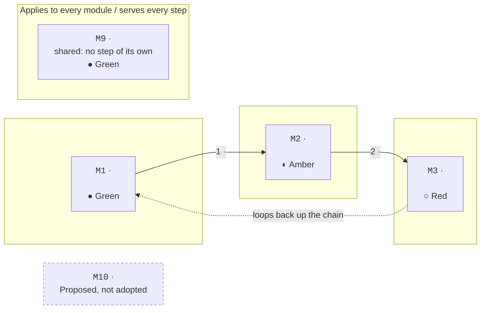
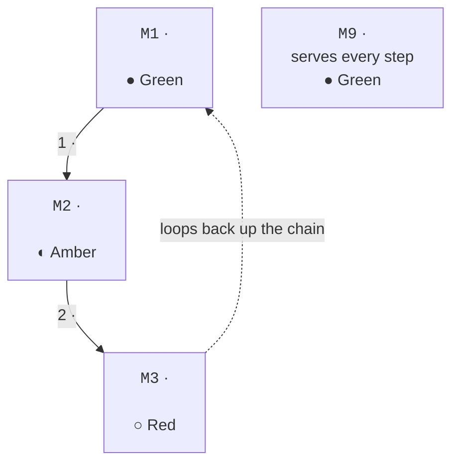

<!--
  The map: the main architecture diagram, the centrepiece of the
  front page (section 3.0). Drawn from text [mermaid] so GitHub can
  draw it on a phone.

  The whole diagram is GENERATED from blueprint.yaml (modules, steps,
  part lights): never draw or edit it by hand. The layouts below show
  the shape the page builder fills in; <…> are the generated values.

  Each box: mono ID · bold name · one-line role · light dot and label,
  linking to its card. Lights are generated. Proposed modules are
  shown as "Proposed, not adopted" and never scored.
-->

# The map

## The one-cut rule

- **Process product** (its work moves through steps): the map draws
  the loop as a numbered path through the modules, each step with
  exactly one owning module, plus a "serves every step" column for
  shared modules.
- **Pipeline product** (its work flows through stages, e.g. "get the
  facts right" → the central "waist" → "get the conclusions right"):
  the stages *are* the path, unchanged.

## Wide layout (desktop)

Left to right; the "serves every step" column sits below the path.

<!-- generated -->
<!-- from: blueprint.yaml (modules, steps, part lights) -->

<!-- /generated -->

## Tall layout (phone)

Top to bottom, one box per line, so nothing scrolls sideways.

<!-- generated -->
<!-- from: blueprint.yaml (modules, steps, part lights) -->

<!-- /generated -->

## Under the map

<!-- generated -->
- **"Applies to every module" band** [G, once there are shared rules
  or services]: shared rules · shared services · loops back up the
  chain
- **Card legend line:** ● Green · ◐ Amber · ○ Red · `ID` coloured by
  plane or zone · ◆n checkpoint
<!-- /generated -->

## The phone layout

- The **tall** map above.
- The pinned contents bar becomes a sticky menu.
- Tables keep the same columns and scroll sideways.
- Folds stay folded; the answer is always shown above each fold.
